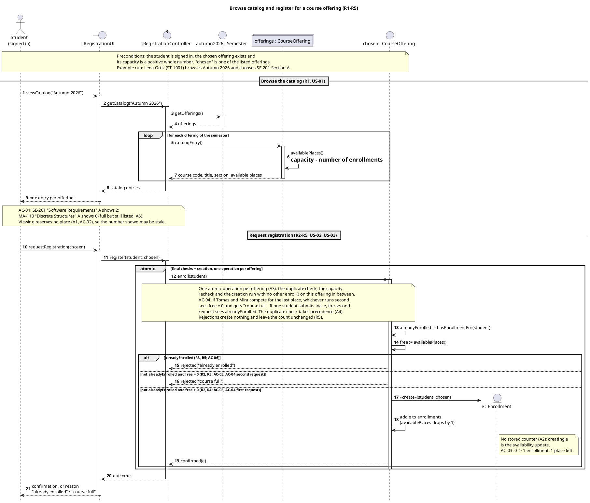
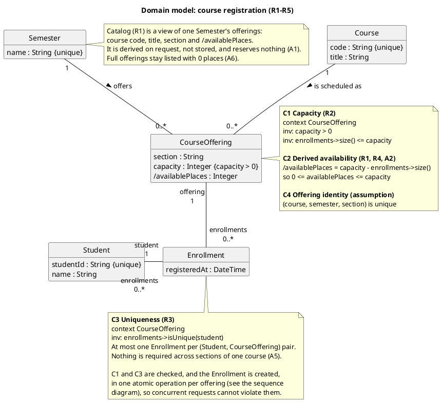

## Sequence diagram

## Domain class diagram

## Constraints

- **C1 Capacity (R2):** `capacity > 0`, and an offering never has more Enrollments than its capacity.
- **C2 Derived availability (A2):** `availablePlaces = capacity − number of Enrollments`. It always stays between 0 and capacity. It is never stored, so creating an Enrollment is the update R4 asks for.
- **C3 Uniqueness (R3):** a student has at most one Enrollment per offering. A repeat request is rejected with "already enrolled".
- **Enforcement:** both C1 and C3 are guaranteed by the atomic `enroll()` on the offering. Every Enrollment links exactly one Student and one CourseOffering (the 1-multiplicities, R4).

## Assumptions and modelling decisions

Beyond your approved A1–A7, I made these choices:

1. **The atomic operation belongs to `CourseOffering.enroll()`.** The offering owns its capacity and its Enrollments, so it is the natural boundary for "one operation per offering" (A3). How the operation is made atomic (locks, transactions) is left out, as you specified.
2. **There are three branches with mutually exclusive guards.** Both values are read inside the atomic group. The guards include "not alreadyEnrolled", so a repeat request for a full offering gets "already enrolled" (A4).
3. **The reply is outside the atomic group.** Only the checks and the creation are atomic. The single `outcome` reply carries the confirmation or the reason, and how it is delivered is out of scope.
4. **Concurrency is shown as a note, not a second actor.** Using one generic Student keeps the diagram readable. AC-04 and the double-submit case are explained in the atomic note. A `par` fragment with Tomas and Mira would be an alternative if your course expects one.
5. **Catalog is not a class.** It is the derived view of one Semester's offerings and holds no state. Course code and title come through the offering's link to its Course.
6. **Enrollment is a class of its own, not a UML association class.** This makes C3 an explicit constraint rather than leaving it implied by association-class semantics.
7. **Some attributes are not required by R1–R5:** `Student.name`, `Enrollment.registeredAt` and the C4 identity of (course, semester, section). I added them because they are useful for identification and confirmation, but you can drop them.
8. **The domain model has no operations.** `enroll()`, `availablePlaces()` and `hasEnrollmentFor()` in the sequence diagram are responsibilities given to CourseOffering at design level.

## Technical lifelines

- **`:RegistrationUI` (boundary):** the interface the student uses. It forwards requests and shows the catalog and the outcome. It contains no business rules.
- **`:RegistrationController` (control):** coordinates the use case. It identifies the signed-in student and the chosen offering, gets the semester's offerings, hands the atomic `enroll()` to the offering and passes the result back. It holds no business state and performs no checks itself, so R2–R5 stay in the domain.

Neither appears in the class diagram because they are not domain concepts. For a black-box view, both can be merged into a single `:RegistrationSystem` lifeline. The other lifelines (Semester, the `offerings` multi-object, the chosen CourseOffering and the created Enrollment) are domain objects.

I haven't rendered the diagrams here; the syntax is standard PlantUML (`create`, `group`, `collections`, creole notes).