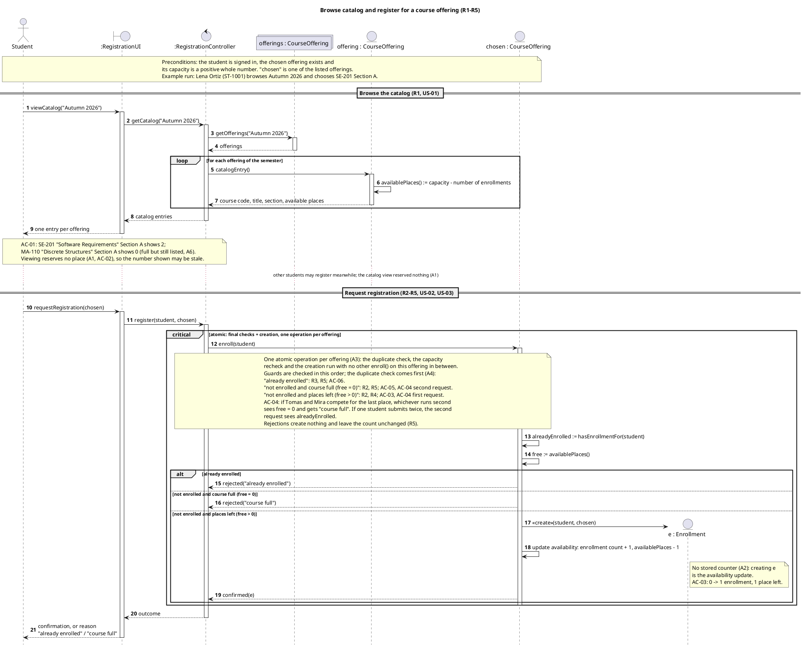
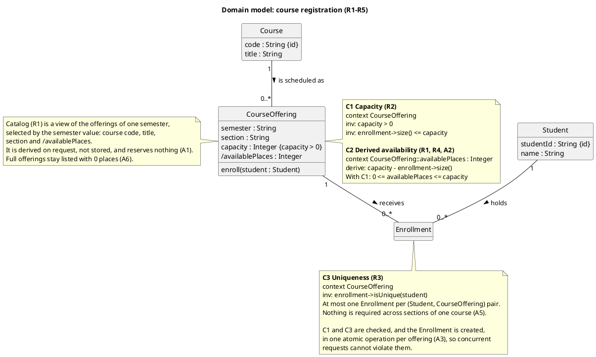

# Revised UML sources: registration sequence and domain model

## models/original/sequence.puml

## models/original/classes.puml

## Change log

**Sequence diagram**
- **M3:** The actor is now "Student", the same name as the class. "Signed in" stays in the precondition note.
- **M1:** I removed the Semester lifeline. The controller now sends `getOfferings("Autumn 2026")` to the offerings collection. The collection only answers that selection.
- **D3:**
  - `catalogEntry()` now goes to a new lifeline "offering : CourseOffering", with no `[i]` selector.
  - Its self-call is on one line, so no label line starts with "=". This fixes the heading problem you saw in the render.
- **O9:** The AC-01 note now says "Section A". I applied this to MA-110 as well as SE-201, because AC-01 uses that wording for both.
- **O2:** I added a delay (`...`) between the browse section and the request section. It says other students may register meanwhile and the catalog view reserved nothing (A1).
- **O1:** `group atomic [...]` is now `critical atomic: final checks + creation, one operation per offering`. The atomic note is kept.
- **D2:**
  - The three guards are plain conditions, in the order you gave.
  - Their rule and AC tags moved into the atomic note, one line per guard.
  - The A4 precedence sentence now introduces those lines.
- **O5 (rejected, relabel only):** The self-message after the create now reads "update availability: enrollment count + 1, availablePlaces - 1".

**Class diagram**
- **M1:** I removed the Semester class and its "offers >" association. CourseOffering gets `semester : String`.
- **D4:** `{unique}` is replaced by `{id}` on `Student.studentId` and `Course.code`.
- **O6:** I removed `Enrollment.registeredAt`.
- **O8:** I added only `enroll(student : Student)` to CourseOffering.
- **D1:** I deleted C4.
- **O9:**
  - C2 is in OCL derive form.
  - I moved its bound line out of the OCL into a prose line ("With C1: …") so it does not read as part of the derive expression.
  - The labels now run C1, C2, C3 in reading order.
  - The Enrollment note cites A3.
- **M2:**
  - Every multiplicity is a plain "1" or "0..*".
  - The associations are named "receives >" (CourseOffering to Enrollment) and "holds >" (Student to Enrollment).
  - I dropped `-right-`.
  - The OCL uses the default end names `enrollment` and `student`.

**Kept unchanged by decision:**
- The browse flow.
- `enroll()` on "chosen" as the atomic boundary.
- Reading alreadyEnrolled and free inside the critical region.
- The three replies from the offering and the single outcome reply outside the region.
- Derived availability, C1, C3, and the A2/AC-03 note at the create.

O3, O4 and O7 led to no edits. Scope, R1–R5, A1–A7, AC-01–AC-06 and the C1–C3 IDs are all preserved.

## Flags
1. **Catalog note (my interpretation of M1):** The old Semester note still carries R1, A1 and A6 content. So I moved it to CourseOffering instead of deleting it with the class. Delete it if you meant it to go with Semester.
2. **Critical label shown in brackets:** PlantUML normally prints the text after `critical` in brackets, as it did with the guards. It may therefore look like a guard, although it is only a label. Please check the render.
3. **Empty Enrollment compartment:** After O6, Enrollment has no attributes. Since only `hide empty methods` is set, PlantUML will draw an empty attribute compartment. This is valid UML; `hide empty members` would remove it, but I have not applied that.
4. **Not rendered or saved:** I have not rendered these blocks or written them to disk. Please re-render to confirm the D2 and D3 fixes.