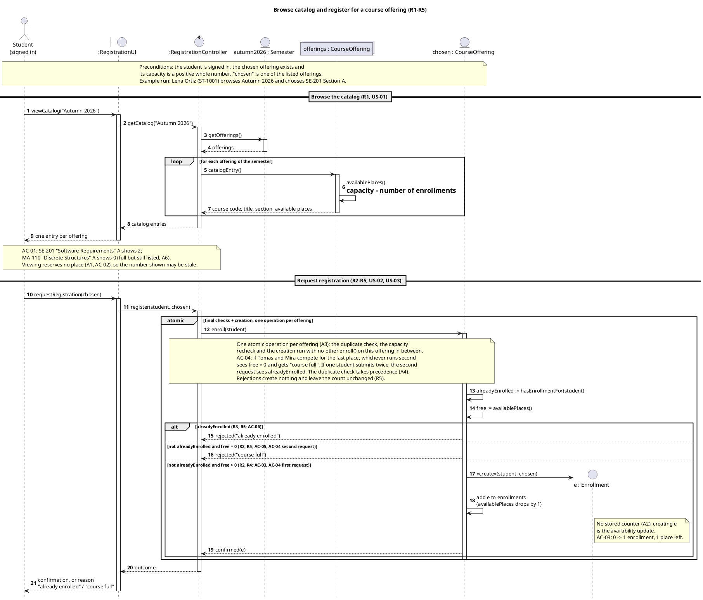
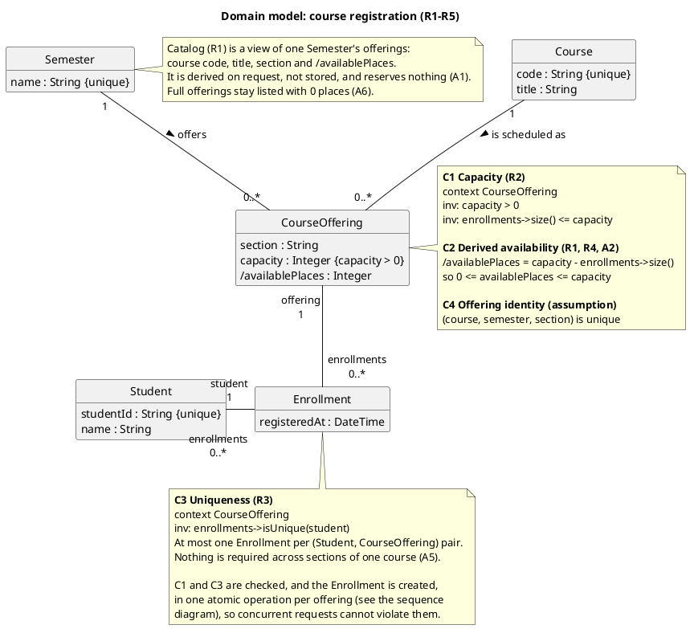
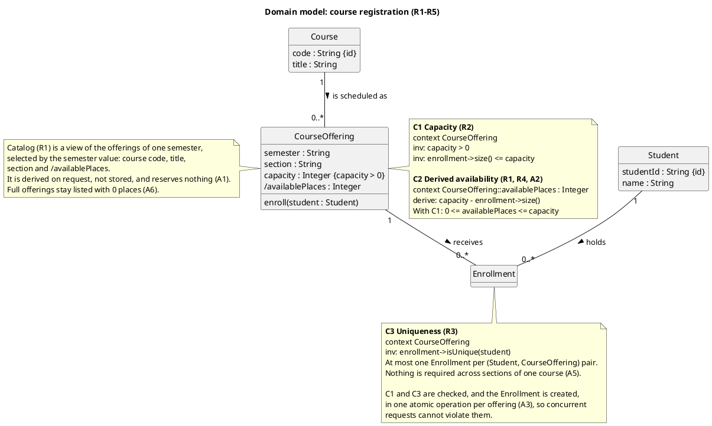

# SIS #02 — AI-Assisted UML Modeling: University Course Registration

<!--
  This is the only file you write your report in. README.md tells you what goes where.

  Rules the checker relies on:
  - Do not delete, rename or renumber the ## headings, the ### headings, or the **Label:** words.
  - Replace every "(write here)" and "(paste here)". None may be left when you submit.
  - Comments like this one are ignored by the checker and the word counter. Delete them or leave them.
-->

## 1. Scope and assumptions

<!-- Your FINAL scope statement and assumptions, after reviewing Prompt A's output. Say here
     what is out of scope (payments, prerequisites, timetable clashes, waiting lists,
     cancellation) — section 2 must not mention them. Section 10 keeps your first version. -->

**Scope:** One signed-in student browses the catalog of one semester, which shows each offering's course code, title, section and available places, picks a course offering and asks to register. When the request arrives the system rechecks, in one atomic operation, whether the student already holds an Enrollment in that offering and whether a place is still free, then either creates exactly one Enrollment and confirms it, or rejects the request with "already enrolled" or "course full" and changes nothing.

**Out of scope:** payments, prerequisites, timetable clashes, waiting lists and cancellation, which the scenario excludes. Also not modeled: how the confirmation is delivered, technical failures outside R5, and any database detail beyond a note that the final checks and the creation are atomic.

**Assumptions:**

1. A catalog view reserves nothing; the available places a student saw can be out of date when the request arrives, which is why R2 rechecks them.
2. Available places = capacity − number of Enrollments of the offering. They are derived, not stored, so creating the Enrollment is the availability update that R4 asks for (B1 uncertainty U-04).
3. The duplicate check, the capacity check and the creation of the Enrollment form one atomic operation per offering. This covers two students asking for the last place at once and also one student sending the same request twice at once (B1 suggested extending initial assumption 4 of §10 to duplicates; accepted).
4. If a request is both a repeat and for a full offering, the reason is "already enrolled": the duplicate check runs first, because that answer is true whatever the capacity (B1 uncertainty U-01, which B1 left open; decided during the review).
5. R3 limits repeats in the same offering only. Whether a student may hold places in two sections of one course is not decided by the rules, and no policy is added for it (U-02).
6. Full offerings stay in the catalog with 0 available places; the catalog is asked for one semester at a time (U-05, U-06).
7. Example data is fictional: students Lena Ortiz (ST-1001), Tomas Reyes (ST-1002) and Mira Holm (ST-1003); courses SE-201 "Software Requirements" and MA-110 "Discrete Structures"; semester Autumn 2026.

## 2. User stories and acceptance criteria

<!-- Your APPROVED requirements: Prompt A's draft after your review. Keep the IDs, the three
     story headings and the bullet shape. Every criterion names the rule(s) it maps to,
     e.g. (R2, R4). Two criteria per story. Nothing out of scope.
     Format of a criterion, on one bullet:
     - **AC-03** (R2, R4): Given ..., When ..., Then ... -->

### US-01 — Browse offerings

**US-01:** As a student, I want to see one semester's course offerings with their available places, so that I can choose an offering to register for.

- **AC-01** (R1): Given the Autumn 2026 catalog holds SE-201 "Software Requirements" Section A (capacity 2, 0 Enrollments) and MA-110 "Discrete Structures" Section A (capacity 20, 20 Enrollments), When Lena views the catalog for Autumn 2026, Then each offering is listed as its own entry with its course code, course title, section and available places, SE-201 Section A showing 2 and MA-110 Section A showing 0.
- **AC-02** (R1, R2): Given SE-201 Section A has capacity 2 and 1 Enrollment, When Tomas views the Autumn 2026 catalog, Then SE-201 Section A shows 1 available place (capacity minus Enrollments), And the enrollment count stays 1, because viewing the catalog holds no place for Tomas.

### US-02 — Register for an offering

**US-02:** As a student, I want to request registration for the offering I chose, so that I get a confirmed place in it while a place is free.

- **AC-03** (R2, R4): Given SE-201 Section A has capacity 2 and 0 Enrollments and Lena has no Enrollment in it, When Lena requests registration for SE-201 Section A, Then availability is rechecked at that moment, exactly one Enrollment linking Lena and SE-201 Section A is created, the enrollment count becomes 1 with 1 place left, And Lena receives a confirmation.
- **AC-04** (R2, R4, R5): Given SE-201 Section A has capacity 2 and 1 Enrollment and neither Tomas nor Mira holds an Enrollment in it, When Tomas and Mira request registration for SE-201 Section A at almost the same moment, Then exactly one of them gets a new Enrollment and a confirmation and the enrollment count becomes 2 with no place left, And the other is rejected with "course full" and gets no Enrollment, so the count never exceeds 2.

### US-03 — Receive a clear rejection

**US-03:** As a student, I want a clear reason when my registration request is rejected, so that I know why and that nothing was recorded.

- **AC-05** (R2, R5): Given Mira saw 1 available place for SE-201 Section A in the catalog, that place has since been taken so the offering now has 2 Enrollments for capacity 2, and Mira holds no Enrollment in it, When Mira requests registration for SE-201 Section A, Then the request is rejected with the reason "course full", And no Enrollment is created and the enrollment count stays 2.
- **AC-06** (R3, R5): Given SE-201 Section A has capacity 2 and 1 Enrollment, which is Lena's, When Lena requests registration for SE-201 Section A again, Then the request is rejected with the reason "already enrolled", And no Enrollment is created, the enrollment count stays 1 and Lena still holds exactly one Enrollment in it.

## 3. Sequence diagram

<!-- The FINAL diagram, rendered. Change .png to .svg if that is what you exported. -->


**Participants:**

- `Student` (actor): the signed-in student, e.g. Lena Ortiz (ST-1001). It has the same name as the class in §4.
- `:RegistrationUI` (boundary): the screen the student uses. It passes requests on and shows the catalog and the outcome.
- `:RegistrationController` (control): coordinates the two steps of the use case. It holds no state and checks no rule.
- `offerings : CourseOffering` (collection): all offerings. It only answers `getOfferings("Autumn 2026")` (message 3).
- `offering : CourseOffering`: the offering the catalog loop is reading at that moment (messages 5–7).
- `chosen : CourseOffering`: the offering the student picked. It owns the atomic `enroll(student)` (messages 12–19).
- `e : Enrollment`: created by message 17, and only in the success branch.

**Atomic operation:** the `critical` region labelled "atomic: final checks + creation, one operation per offering" holds messages 12–19:
- `enroll(student)` (12);
- the final duplicate check, `alreadyEnrolled := hasEnrollmentFor(student)` (13);
- the capacity recheck, `free := availablePlaces()` (14);
- the three guarded branches;
- in the success branch only: `«create»(student, chosen)` (17), the availability update (18) and `confirmed(e)` (19).

In UML a critical region cannot be interleaved by other traces on its lifelines (§13). Two requests for the last place therefore run one after the other, and the second one computes `free = 0` in its own message 14.

A catalog view reserves nothing. Messages 1–9 lie outside the region and only read: message 6 computes places, and nothing there creates or updates. The delay line ("other students may register meanwhile") marks the gap. Message 10, `requestRegistration(chosen)`, carries only the offering and not the number the student saw, so a stale catalog number cannot influence the decision.

**Where the Enrollment is created:** message 17, `«create»(student, chosen)`. The `chosen : CourseOffering` lifeline sends it to the new `e : Enrollment` lifeline, inside the branch guarded "not enrolled and places left (free > 0)". It produces one object of the `Enrollment` class in §4, linked at creation to exactly one `Student` and one `CourseOffering`.

**Technical lifelines:** `RegistrationUI` (boundary) and `RegistrationController` (control) are not classes in the class diagram. They are design-level participants: they carry the request in and the reply out, but they own no data and enforce no rule (R2–R5 are all decided inside `chosen.enroll()`). A domain class diagram shows only domain concepts, as the Practice 04 handout says (§13), so leaving them out of §4 is the expected difference in abstraction, not an inconsistency. Every other lifeline is an instance of a domain class: `Student`, three roles of `CourseOffering`, and `Enrollment`.

## 4. Class diagram

<!-- The FINAL diagram, rendered. -->


<!-- One row per association in classes.puml, read in both directions. -->

| Association | Read left to right | Read right to left |
| --- | --- | --- |
| `Course "1" -- "0..*" CourseOffering : is scheduled as >` | One Course is scheduled as zero or more CourseOfferings; SE-201 has Section A in Autumn 2026. | Each CourseOffering is a scheduling of exactly one Course, which gives the catalog its code and title. |
| `CourseOffering "1" -- "0..*" Enrollment : receives >` | One CourseOffering receives zero or more Enrollments, never more than its capacity (C1). | Each Enrollment belongs to exactly one CourseOffering. |
| `Student "1" -- "0..*" Enrollment : holds >` | One Student holds zero or more Enrollments, at most one per offering (C3). | Each Enrollment is held by exactly one Student. |

**How an Enrollment links a student to an offering:** an Enrollment has exactly one `Student` end and exactly one `CourseOffering` end, so each Enrollment object is one (student, offering) pair. It has no attributes of its own. It is created in one place only: message 17 of the sequence diagram, `«create»(student, chosen)`, which sets both ends at creation. A student's registrations are the Enrollments the student holds. An offering's enrollment count is the number of Enrollments it receives, and `/availablePlaces` is derived from that count (C2), so creating the Enrollment is also the availability update that R4 asks for.

**Capacity constraint:** C1 (R2): `context CourseOffering inv: enrollment->size() <= capacity`, together with `capacity > 0`. Multiplicity cannot express this. A multiplicity is written once on the association and is the same for every offering (`0..*`), but the limit differs per offering (2 for SE-201 Section A, 20 for MA-110 Section A) and is stored as an attribute value. C1 must hold after every request, so the final count check runs inside the atomic `enroll()`.

**Uniqueness constraint:** C3 (R3): `context CourseOffering inv: enrollment->isUnique(student)`, at most one Enrollment per (Student, CourseOffering) pair. Multiplicity cannot express this either. The `0..*` on each Enrollment end only counts how many Enrollments one student or one offering has. Two Enrollment objects that both link Lena to SE-201 Section A would satisfy every multiplicity in the diagram; only a constraint that looks at both associations at once forbids them. C3 is checked by message 13, inside the same atomic operation as C1.

## 5. Traceability

<!-- Every rule, including the catalog fields and availability (R1). Column 1: the rule and
     the criteria that cover it, e.g. "R2 + AC-03, AC-04". Column 2: the message, guard,
     class or constraint that shows the rule in YOUR diagrams. Column 3: the T-ID that
     exercises it, or the extra check you did instead (R1 has no T case). -->

| Rule and criterion | Model evidence | Validation case |
| --- | --- | --- |
| R1 + AC-01, AC-02 | Sequence messages 1–9: `viewCatalog("Autumn 2026")` → `getOfferings("Autumn 2026")` → loop `catalogEntry()` → message 6 `availablePlaces() := capacity - places taken (C2)` → message 7 "course code, title, section, available places". Class: `Course.code`, `Course.title`, `CourseOffering.semester`, `section`, `/availablePlaces`, constraint C2. | No T case. Extra check instead: AC-01 traced with its data on messages 5–7 (SE-201 Section A gives 2 − 0 = 2, MA-110 Section A gives 20 − 20 = 0, and both are listed because the loop has no filter). AC-02: messages 1–9 contain no create or update, so the count stays 1. |
| R2 + AC-02, AC-03, AC-04, AC-05 | Message 14 `free := availablePlaces()` after request 10 and inside the `critical` "atomic" region; guard "not enrolled and course full (free = 0)"; the delay "the catalog view reserved nothing (A1)"; class constraint C1 `enrollment->size() <= capacity`. | T3 (recheck after a stale view), T2 (count reaches capacity), T1 |
| R3 + AC-06 | Message 13 `alreadyEnrolled := hasEnrollmentFor(student)` inside the atomic region; guard "already enrolled", evaluated first because the other two guards contain "not enrolled"; class constraint C3 `enrollment->isUnique(student)`. | T4 |
| R4 + AC-03, AC-04 | Guard "not enrolled and places left (free > 0)"; message 17 `«create»(student, chosen)`, message 18 "update availability: enrollment count + 1, availablePlaces - 1", message 19 `confirmed(e)`, message 21 confirmation. Class: Enrollment with `Student "1"` and `CourseOffering "1"` ends. | T1, T2 |
| R5 + AC-04, AC-05, AC-06 | Message 15 `rejected("already enrolled")` and message 16 `rejected("course full")`, each the only message in its branch, so nothing is created or updated there; message 21 returns the reason to the student. | T3, T4 |

## 6. Walkthroughs

<!-- Walk each case through YOUR final sequence diagram, message by message. Column 2: the
     actual steps and the state change (count before → after). Column 3 starts with Pass or
     Fail, then the location: the message, guard or note where you saw it. A Fail you
     report honestly is a finding, not a penalty. -->

<!-- Traced and written by the Claude Code agent session for David; see AI_USAGE.md. -->

| Case | Observed path and state change | Judgment and evidence |
| --- | --- | --- |
| T1. Available | SE-201 Section A, capacity 2, 0 Enrollments; Lena is new. 1–9: message 6 gives 2 − 0 = 2 and the catalog shows 2. 10 `requestRegistration(chosen)` → 11 `register(Lena, chosen)` → 12 `enroll(Lena)` enters the critical region → 13 `alreadyEnrolled` = false → 14 `free` = 2 − 0 = 2. "already enrolled" is false, "not enrolled and course full (free = 0)" is false, "not enrolled and places left (free > 0)" is true → 17 `«create»(Lena, chosen)` makes e → 18 count 0 → 1, available 2 → 1 → 19 `confirmed(e)` → 20 `outcome` → 21 confirmation. State: one new Enrollment (Lena, SE-201 A); count 0 → 1. | Pass. Success branch "not enrolled and places left (free > 0)", messages 17–19: exactly one create, count 1, and the confirmation (19, 21) only after the create. |
| T2. Last place | Same offering, capacity 2, 1 Enrollment (Lena); Tomas is new. 10 → 11 `register(Tomas, chosen)` → 12 `enroll(Tomas)` → 13 `alreadyEnrolled` = false → 14 `free` = 2 − 1 = 1 → the success guard is true → 17 `«create»(Tomas, chosen)` → 18 count 1 → 2, available 1 → 0 → 19 `confirmed(e)` → 21 confirmation. State: count 1 → 2 = capacity. The next message 14 on this offering, or message 6 in a new catalog view, gives 2 − 2 = 0. | Pass. Message 14 (free = 1) and messages 17–18: count becomes 2 and no place remains. The critical region means a simultaneous second request reaches its message 14 only after this request has left the region (after message 19), so it sees free = 0 (AC-04). |
| T3. Full | Mira viewed the catalog while the offering had 1 Enrollment: message 6 gave 2 − 1 = 1 and message 9 showed 1 place. At the delay line, Tomas registers (T2), so the count is now 2 of 2. Mira: 10 `requestRegistration(chosen)`, which carries no place count → 11 → 12 `enroll(Mira)` → 13 `alreadyEnrolled` = false → 14 `free` = 2 − 2 = 0 → "already enrolled" is false, "not enrolled and course full (free = 0)" is true → 16 `rejected("course full")`, the only message in that branch → 20 `outcome` → 21 reason "course full". State: no Enrollment created; count stays 2. | Pass. Message 14 recomputes free inside the critical region instead of reusing the stale value from message 9; guard "not enrolled and course full (free = 0)" and message 16 return the reason and change nothing. |
| T4. Duplicate | Capacity 2, 1 Enrollment, which is Lena's; Lena asks again. 10 → 11 `register(Lena, chosen)` → 12 `enroll(Lena)` → 13 `alreadyEnrolled` = true → 14 `free` = 2 − 1 = 1 → "already enrolled" is true. The success guard is false even though free = 1, because it requires "not enrolled" → 15 `rejected("already enrolled")` → 20 `outcome` → 21 reason "already enrolled". State: no Enrollment created; count stays 1; Lena still holds exactly one. | Pass. Message 13 and the guard "already enrolled", then message 15; nothing in that branch creates, updates or confirms. |

## 7. Review decisions

<!-- At least three substantive decisions about Prompt C's critique or your own inspection.
     Decision: accepted / rejected / modified — and what you did. Reason: why, in a full
     sentence. Rule: R1–R5. Do not invent an error to fill the table; a justified rejection
     of advice counts. -->

| AI suggestion or model element | Decision | Reason | Rule |
| --- | --- | --- | --- |
| B1 (Prompt A), AC-05: "and the request is not queued" | Rejected: removed from AC-05 | Not queuing is the excluded waiting-list feature in other words, and §2 must not mention excluded features at all. | R5 |
| B3 verdict: "Both models meet R1–R5 and all six acceptance criteria" | Accepted after checking; the behaviour of the original was kept | T1–T4 were traced through the original's messages 12–19: checks after the request, creation only under free > 0, confirmation after creation, rejections with one message each. So the revision changes notation and traceability, not the flow. | R2, R3, R5 |
| B3 D2: guards carry rule tags such as `alreadyEnrolled (R3, R5; AC-06)` | Modified: guards "already enrolled", "not enrolled and course full (free = 0)" and "not enrolled and places left (free > 0)"; the tags moved into the atomic note | The tags were printed inside the guard brackets in original-sequence.png. "not enrolled" stays in the second and third guards because UML 2.5.1 §17.6.3.7 gives alt no evaluation order, so only mutually exclusive guards make "already enrolled" win when both reasons apply (A4). | R3, R5 |
| B3 D3: catalog messages go to the `offerings` collection; its fix is `offerings[i] : CourseOffering` | Modified: a per-offering lifeline `offering : CourseOffering` with no selector, and the formula on one line | R1's value is per offering (2 versus 0 in AC-01). UML 2.5.1 §17.12.17.5 allows only a literal integer or string as a selector, so `[i]` is invalid. A render check of original-sequence.png also showed that the original label `\n= capacity - …` turned into a large heading with its "=" lost, which the critique could not see without rendering. | R1 |
| B3 O1: use `critical` instead of `group atomic [...]` | Accepted | A PlantUML `group` has no UML meaning, while UML 2.5.1 §17.6.3.14 defines a critical region as one other traces cannot interleave, which is exactly what stops two requests taking the same last place. | R2 |
| B3 D4: `{unique}` on `studentId`, `code`, `Semester.name` | Accepted: `{id}` on `Student.studentId` and `Course.code` | UML 2.5.1 §7.5.3.2 says isUnique has no effect on a single-valued element and §9.5.4 says `{id}` marks the identifier, so the original never stated which attribute identifies a student or a course. | R1, R3 |
| B3 D1: constraint C4, "(course, semester, section) is unique" | Accepted: C4 deleted | No rule in R1–R5 and no approved assumption asks for an offering identity, and Prompt A forbids inventing university policies. | R1 |
| B3 O5: delete the self-message "add e to enrollments (availablePlaces drops by 1)" | Rejected; relabelled "update availability: enrollment count + 1, availablePlaces - 1" | R4 names "update availability" as an effect of its own, and the T1 and T2 walkthroughs read the count change at this message (18); deleting it would leave the state change only in a note. | R4 |
| B3 O7: model Enrollment as an association class | Rejected | An explicit Enrollment class with `1` and `0..*` ends plus the C3 note states uniqueness openly, and the assignment asks for the uniqueness constraint to be written in a note. | R3 |
| Original class `Semester` with `name {unique}` and its `offers` association (found on inspection, not raised in B3) | Modified: Semester removed; `CourseOffering.semester : String` added | Semester had one attribute and no rule constrains it; R1 needs the semester only as the value that selects one semester's catalog. The original was not wrong, so this is a simplification, recorded as one. | R1 |
| Original multiplicities with role names, `"student\n1"` and `"enrollments\n0..*"` (found on inspection) | Modified: plain `"1"` and `"0..*"`; associations named "holds >" and "receives >"; OCL uses the default end names | In original-classes.png these labels crowded the short Student–Enrollment link. Plain multiplicities read cleanly at both ends: each Enrollment has exactly one Student and one CourseOffering. | R3, R4 |
| B4 result, message 6 "availablePlaces() := capacity - number of enrollments" (edited after Prompt D) | Modified: "availablePlaces() := capacity - places taken (C2)" | Because the label contained "enrol", the checker's SQ2 took this catalog step as the registration request, so its SQ4 window began inside the catalog view. The new label means the same (C2) and makes message 10 the request. | R2 |
| B4 flags 1–3: catalog note moved to CourseOffering, `critical` label shown in brackets, empty Enrollment compartment | Accepted as they are, after checking the renders | The catalog note carries the R1, A1 and A6 content and has to stay; the critical header reads as an operator label, not a guard; and an empty attribute compartment is valid UML and shows that Enrollment holds only its two links. | R1 |

## 8. Modeling explanation

<!-- 200–300 words. Your main design choices; how the class diagram and the sequence diagram
     complement each other; why an activity diagram could also help explain the workflow. -->

The model keeps the four required classes. Availability is derived, not stored: `/availablePlaces = capacity − enrollment->size()` (C2). Creating an Enrollment is therefore the availability update R4 asks for, and no separate counter can drift away from the real number of Enrollments. The whole decision sits in one operation, `CourseOffering.enroll(student)`, because the offering owns both its capacity and its Enrollments. In the sequence diagram this operation is a UML `critical` region. The duplicate check (message 13), the capacity recheck (14) and the creation (17) cannot be interleaved with another request, so two students cannot both take the last place, and one student cannot register twice with a double submit. The three guards exclude each other and put "already enrolled" first. The catalog is a read-only view outside that region: it computes places for each offering and reserves nothing.

The two diagrams answer different questions. The class diagram states what must always be true. Every Enrollment joins exactly one Student and one CourseOffering, and the notes C1 and C3 state the capacity and uniqueness rules that multiplicities cannot express. The sequence diagram states when and where those rules are checked: after the request, inside the atomic region, before anything is created. It also shows that rejections only return a reason. Each walkthrough in §6 needs both diagrams: the message path comes from the sequence diagram, and the end state is judged against the class invariants.

An activity diagram could also help, because the registration logic is a decision procedure. It has two checks in a fixed order and exactly one path that creates something. Without lifelines or messages, an activity diagram would show that order, the single creating path and the two exits that change no state, which a reader outside the team can check against R3 and R5 more easily.

## 9. Reflection

<!-- 150–200 words. Written by you, not by the assistant: where AI helped, one decision you
     made yourself, one remaining limitation. Specific beats flattering. -->

<!-- Drafted by the Claude Code agent session for David, from what happened in this run; see AI_USAGE.md. -->

The AI helped most by finding a gap in the §10 baseline. Prompt A noticed that initial assumption 4, about two students racing for the last place, did not cover one student sending the same request twice, so the atomic operation now includes the duplicate check. The critique in Prompt C pointed out that `{unique}` on a single attribute says nothing, and the UML 2.5.1 specification confirms this on pages 34 and 114.

It was also wrong in ways that only checking revealed. Prompt A slipped "the request is not queued" into AC-05, which is the excluded waiting list in other words. The original sequence diagram rendered its availability formula as a large heading, and the critique missed this because it never rendered anything. Its fix `offerings[i]` breaks the UML rule that a lifeline selector must be a literal.

One decision came from none of the four prompts: removing the `Semester` class and keeping `semester` as an attribute, because no rule constrains a semester.

One limitation remains. The race for the last place is only described in a note, not drawn. A `par` fragment with two students would show it directly.

## 10. Appendix A — Before AI

<!-- Written BEFORE you run Prompt A, committed and pushed in your first commit, and never
     edited afterwards. This is what you paste into Prompt A as "My initial assumptions". -->

**Scope:** One signed-in student browses the course catalog of one semester, picks a course offering and asks to register; at that moment the system rechecks whether the student is already enrolled and whether the offering still has a free place, then either creates exactly one Enrollment and confirms it or rejects the request with "course full" or "already enrolled" and changes nothing.

**Initial assumptions:**

1. There is no waiting list: a request for a full offering is rejected and nothing is queued.
2. A catalog view does not reserve a place, so the free places a student saw may be out of date by the time the request arrives.
3. The free places of an offering are its capacity minus the number of Enrollments it already has.
4. Two students can ask for the last place at almost the same moment; only one of them may get it.

## 11. Appendix B — AI exchanges

<!-- Complete prompts and complete responses, as text — never screenshots. Paste each inside
     the ~~~~ block that follows its label: AI responses contain ``` PlantUML blocks, and
     ~~~~ keeps them from breaking this file. Prompts B and C: the prompt text first, then
     the material it refers to ("below", "these two") pasted under it, in the same block.
     You may add B5, B6 … after B4 if you ran more. -->

### B1 — Requirements (Prompt A)

- **Tool:** Claude Code v2.1.296 (headless claude -p, tools disabled)
- **Model:** claude-opus-5-5 (Claude Opus 5.5)
- **Date:** 2026-10-11
- **Purpose:** draft 3 user stories and 6 acceptance criteria

<!-- Model: the exact model with its version, as the tool shows it (e.g. "GPT-5 Thinking",
     "Claude Sonnet 4.5"). If the tool does not show it, write: not displayed
     Date: YYYY-MM-DD -->

**Prompt:**

~~~~text
Act as a requirements analyst. Use only this course registration scenario and rules R1–R5:

Scenario: A student browses an electronic course catalog, chooses a course offering and requests registration. Each offering has a limited number of places. A Course describes a subject. A CourseOffering is one scheduled section in one semester. Registration always targets a specific offering. Assume that the student is signed in, the selected offering exists, and its capacity is a positive whole number. Exclude payments, prerequisites, timetable clashes, waiting lists and cancellation. Use fictional students and courses.

R1. Catalog: Show the course code, title, offering and available places for one semester.
R2. Capacity: Recheck current availability when registering. Enrollment must never exceed the offering's capacity.
R3. Duplicates: A student may have at most one enrollment in the same offering. Reject a repeat request.
R4. Success: Create exactly one Enrollment linking the student and offering, update availability and return a confirmation.
R5. Rejection: Explain "course full" or "already enrolled". Create no enrollment and leave the enrollment count unchanged.

These rules define this assignment. A catalog view does not reserve a place. Model the final checks and enrollment creation as one atomic operation so competing requests cannot take the same last place. A note describing the atomic operation is sufficient; database implementation is outside this assignment. My initial assumptions are

1. There is no waiting list: a request for a full offering is rejected and nothing is queued.
2. A catalog view does not reserve a place, so the free places a student saw may be out of date by the time the request arrives.
3. The free places of an offering are its capacity minus the number of Enrollments it already has.
4. Two students can ask for the last place at almost the same moment; only one of them may get it.
Draft 3 user stories and 2 Given / When / Then acceptance criteria for each. Use IDs US-01 to US-03 and AC-01 to AC-06. Map each criterion to rule IDs.
Cover normal and rejection behavior. List uncertainty separately. Do not add excluded features or invent university policies.
~~~~

**Response:**

~~~~text
# Course Registration: User Stories and Acceptance Criteria

## Fictional Test Data

| Element | Values |
|---|---|
| Students | Lena Ortiz (ST-1001), Tomas Reyes (ST-1002), both signed in |
| Semester | Autumn 2026 |
| Courses | SE-201 "Software Requirements", MA-110 "Discrete Structures" |
| Offerings | SE-201 Section A (capacity 30), SE-201 Section B (capacity 25), MA-110 Section A (capacity 20) |

**Terms:** *Enrollment count* means the number of Enrollments for one offering. *Available places* means capacity minus enrollment count (A3).

## Review of Your Assumptions

| ID | Assumption | Analyst comment |
|---|---|---|
| A1 | No waiting list; full means rejected, nothing queued | Matches the exclusions and R5. |
| A2 | Catalog view reserves nothing; the shown number may be stale | Matches the scenario. This is why R2 requires a recheck. |
| A3 | Available places = capacity − Enrollments | Consistent with R1, R2 and R4. Because cancellation is excluded, every Enrollment counts. |
| A4 | Two students racing for the last place; only one wins | Matches R2. **I suggest extending it** to cover the duplicate check too. One student sending the same request twice at once could otherwise get two Enrollments, which would break R3. |

## User Stories and Acceptance Criteria

### US-01: Browse the course catalog
**As a** student, **I want** to see the offerings of one semester with their available places, **so that** I can choose an offering to register for.

**AC-01: Catalog shows required fields per offering** (R1)
- **Given** semester Autumn 2026 has the offerings SE-201 Section A, SE-201 Section B and MA-110 Section A
- **When** Lena views the catalog for Autumn 2026
- **Then** each offering is listed as a separate entry showing its course code, course title, offering (section) and available places
- **And** SE-201 Section A and SE-201 Section B appear as two entries for the same course

**AC-02: Available places are derived, and viewing reserves nothing** (R1; supports A2, A3)
- **Given** SE-201 Section A has capacity 30 and 28 Enrollments
- **When** Lena views the catalog
- **Then** SE-201 Section A shows 2 available places
- **And** the enrollment count remains 28 and no place is held for Lena

### US-02: Register for an offering with a free place
**As a** student, **I want** to request registration for a chosen offering, **so that** I receive a confirmed place in it.

**AC-03: Successful registration** (R2, R4)
- **Given** SE-201 Section A has capacity 30 and 28 Enrollments, and Lena has no Enrollment in it
- **When** Lena requests registration for SE-201 Section A
- **Then** current availability is rechecked at the time of the request
- **And** exactly one Enrollment linking Lena and SE-201 Section A is created
- **And** the enrollment count becomes 29 and available places become 1
- **And** Lena receives a confirmation

**AC-04: Competing requests for the last place** (R2, R4, R5; A4)
- **Given** SE-201 Section B has capacity 25 and 24 Enrollments, and neither Lena nor Tomas has an Enrollment in it
- **When** Lena and Tomas request registration for SE-201 Section B at almost the same moment
- **Then** exactly one request succeeds and creates one Enrollment, and that student receives a confirmation
- **And** the other request is rejected with "course full" and creates no Enrollment
- **And** the final enrollment count is 25, never 26

### US-03: Understand why registration was rejected
**As a** student, **I want** a clear reason when my registration is rejected, **so that** I know nothing was recorded and why.

**AC-05: Offering became full after the catalog was viewed** (R2, R5; A1, A2)
- **Given** Tomas saw 1 available place for MA-110 Section A in the catalog
- **And** that place was then taken, so MA-110 Section A now has capacity 20 and 20 Enrollments
- **And** Tomas has no Enrollment in MA-110 Section A
- **When** Tomas requests registration for MA-110 Section A
- **Then** the request is rejected with the reason "course full"
- **And** no Enrollment is created, the enrollment count remains 20, and the request is not queued

**AC-06: Repeat request for the same offering** (R3, R5)
- **Given** Lena already has an Enrollment in SE-201 Section A, which has capacity 30 and 29 Enrollments
- **When** Lena requests registration for SE-201 Section A again
- **Then** the request is rejected with the reason "already enrolled"
- **And** no Enrollment is created, the enrollment count remains 29, and Lena still has exactly one Enrollment in SE-201 Section A

*AC-06 deliberately leaves free places, so "already enrolled" is the only reason that applies (see U-01).*

## Atomic Operation Note

**RegisterForOffering(student, offering)** is a single indivisible operation:

1. **Duplicate check:** if the student already has an Enrollment in this offering, reject with "already enrolled".
2. **Capacity check:** if the enrollment count is greater than or equal to capacity, reject with "course full".
3. **Create** one Enrollment linking the student and the offering. Available places therefore drop by 1.
4. **Return** a confirmation.

Either all steps take effect or none do. Requests for the same offering are handled one after another, so each request's checks see every earlier successful Enrollment. Two invariants must always hold:
- **Capacity:** for every offering, the enrollment count is at most its capacity.
- **No duplicates:** for every student and offering pair, there is at most one Enrollment.

The order of steps 1 and 2 is not fixed by the rules (see U-01).

## Traceability

| Rule | Acceptance criteria |
|---|---|
| R1 Catalog | AC-01, AC-02 |
| R2 Capacity | AC-03, AC-04, AC-05 |
| R3 Duplicates | AC-06 |
| R4 Success | AC-03, AC-04 |
| R5 Rejection | AC-04, AC-05, AC-06 |

## Uncertainties (to confirm with stakeholders)

| ID | Question | Why it matters |
|---|---|---|
| U-01 | If a student is already enrolled **and** the offering is full, which reason is shown? | R5 defines both reasons but no precedence. This decides the check order in the atomic operation. |
| U-02 | May a student enroll in two different offerings of the **same course** (e.g., SE-201 Sections A and B)? | R3 only forbids repeats of the same offering. The rules are silent here, so no policy was assumed. |
| U-03 | If the same student sends two simultaneous requests, should the second always get "already enrolled"? | This depends on extending A4 to the duplicate check (see the assumption review). |
| U-04 | Is "available places" stored or always calculated? | R4 says "update availability". If it is calculated (A3), the update is implicit. If it is stored, it must change in the same atomic step. |
| U-05 | Are full offerings listed with 0 available places, or hidden? | R1 does not say. |
| U-06 | How is the one semester chosen: does the student pick it, or is there a default? | R1 says only "for one semester". |
| U-07 | What must the confirmation contain, and how is it delivered? | R4 requires a confirmation but does not define it. |
| U-08 | Are "course full" and "already enrolled" exact message texts or just meanings? | This affects how testers verify AC-04 to AC-06. |
| U-09 | What does the student see if registration fails for a reason outside R5, such as a technical error? | Not covered by R1–R5. Atomicity only guarantees that no partial Enrollment is created. |
~~~~

### B2 — UML drafts (Prompt B)

- **Tool:** Claude Code v2.1.296 (headless claude -p, tools disabled)
- **Model:** claude-opus-5-5 (Claude Opus 5.5)
- **Date:** 2026-10-11
- **Purpose:** draft the sequence and class diagrams

**Prompt:**

~~~~text
Using my approved scenario, R1–R5, stories and criteria below, return separate PlantUML code blocks for a sequence diagram and a domain class diagram.
Sequence: include catalog browsing and guarded success, full-course and duplicate outcomes. Model final checks and creation as one atomic operation.
Class: show domain concepts, useful attributes and multiplicities. State the capacity and uniqueness constraints. Explain assumptions and any technical lifelines.

Scenario:
A student browses an electronic course catalog, chooses a course offering and requests
registration. Each offering has a limited number of places.

A Course describes a subject. A CourseOffering is one scheduled section in one semester.
Registration always targets a specific offering.

Assume that the student is signed in, the selected offering exists, and its capacity is a
positive whole number.

Exclude payments, prerequisites, timetable clashes, waiting lists and cancellation. Use
fictional students and courses.

Rules:
R1. Catalog: Show the course code, title, offering and available places for one semester.
R2. Capacity: Recheck current availability when registering. Enrollment must never exceed the offering's capacity.
R3. Duplicates: A student may have at most one enrollment in the same offering. Reject a repeat request.
R4. Success: Create exactly one Enrollment linking the student and offering, update availability and return a confirmation.
R5. Rejection: Explain "course full" or "already enrolled". Create no enrollment and leave the enrollment count unchanged.

These rules define this assignment. A catalog view does not reserve a place. Model the final
checks and enrollment creation as one atomic operation so competing requests cannot take the same
last place. A note describing the atomic operation is sufficient; database implementation is
outside this assignment.

Approved scope and assumptions:

**Scope:** One signed-in student browses the catalog of one semester, which shows each offering's course code, title, section and available places, picks a course offering and asks to register. When the request arrives the system rechecks, in one atomic operation, whether the student already holds an Enrollment in that offering and whether a place is still free, then either creates exactly one Enrollment and confirms it, or rejects the request with "already enrolled" or "course full" and changes nothing.

**Out of scope:** payments, prerequisites, timetable clashes, waiting lists and cancellation, which the scenario excludes. Also not modeled: how the confirmation is delivered, technical failures outside R5, and any database detail beyond a note that the final checks and the creation are atomic.

**Assumptions:**

1. A catalog view reserves nothing; the available places a student saw can be out of date when the request arrives, which is why R2 rechecks them.
2. Available places = capacity − number of Enrollments of the offering. They are derived, not stored, so creating the Enrollment is the availability update that R4 asks for (B1 uncertainty U-04).
3. The duplicate check, the capacity check and the creation of the Enrollment form one atomic operation per offering. This covers two students asking for the last place at once and also one student sending the same request twice at once (B1 suggested extending my initial assumption 4 to duplicates; accepted).
4. If a request is both a repeat and for a full offering, the reason is "already enrolled": the duplicate check runs first, because that answer is true whatever the capacity (B1 uncertainty U-01, my decision).
5. R3 limits repeats in the same offering only. Whether a student may hold places in two sections of one course is not decided by the rules, and no policy is added for it (U-02).
6. Full offerings stay in the catalog with 0 available places; the catalog is asked for one semester at a time (U-05, U-06).
7. Example data is fictional: students Lena Ortiz (ST-1001), Tomas Reyes (ST-1002) and Mira Holm (ST-1003); courses SE-201 "Software Requirements" and MA-110 "Discrete Structures"; semester Autumn 2026.

Approved user stories and acceptance criteria:

### US-01 — Browse offerings

**US-01:** As a student, I want to see one semester's course offerings with their available places, so that I can choose an offering to register for.

- **AC-01** (R1): Given the Autumn 2026 catalog holds SE-201 "Software Requirements" Section A (capacity 2, 0 Enrollments) and MA-110 "Discrete Structures" Section A (capacity 20, 20 Enrollments), When Lena views the catalog for Autumn 2026, Then each offering is listed as its own entry with its course code, course title, section and available places, SE-201 Section A showing 2 and MA-110 Section A showing 0.
- **AC-02** (R1, R2): Given SE-201 Section A has capacity 2 and 1 Enrollment, When Tomas views the Autumn 2026 catalog, Then SE-201 Section A shows 1 available place (capacity minus Enrollments), And the enrollment count stays 1, because viewing the catalog holds no place for Tomas.

### US-02 — Register for an offering

**US-02:** As a student, I want to request registration for the offering I chose, so that I get a confirmed place in it while a place is free.

- **AC-03** (R2, R4): Given SE-201 Section A has capacity 2 and 0 Enrollments and Lena has no Enrollment in it, When Lena requests registration for SE-201 Section A, Then availability is rechecked at that moment, exactly one Enrollment linking Lena and SE-201 Section A is created, the enrollment count becomes 1 with 1 place left, And Lena receives a confirmation.
- **AC-04** (R2, R4, R5): Given SE-201 Section A has capacity 2 and 1 Enrollment and neither Tomas nor Mira holds an Enrollment in it, When Tomas and Mira request registration for SE-201 Section A at almost the same moment, Then exactly one of them gets a new Enrollment and a confirmation and the enrollment count becomes 2 with no place left, And the other is rejected with "course full" and gets no Enrollment, so the count never exceeds 2.

### US-03 — Receive a clear rejection

**US-03:** As a student, I want a clear reason when my registration request is rejected, so that I know why and that nothing was recorded.

- **AC-05** (R2, R5): Given Mira saw 1 available place for SE-201 Section A in the catalog, that place has since been taken so the offering now has 2 Enrollments for capacity 2, and Mira holds no Enrollment in it, When Mira requests registration for SE-201 Section A, Then the request is rejected with the reason "course full", And no Enrollment is created and the enrollment count stays 2.
- **AC-06** (R3, R5): Given SE-201 Section A has capacity 2 and 1 Enrollment, which is Lena's, When Lena requests registration for SE-201 Section A again, Then the request is rejected with the reason "already enrolled", And no Enrollment is created, the enrollment count stays 1 and Lena still holds exactly one Enrollment in it.
~~~~

**Response:**

~~~~text
## Sequence diagram



## Domain class diagram



## Constraints

- **C1 Capacity (R2):** `capacity > 0`, and an offering never has more Enrollments than its capacity.
- **C2 Derived availability (A2):** `availablePlaces = capacity − number of Enrollments`. It always stays between 0 and capacity. It is never stored, so creating an Enrollment is the update R4 asks for.
- **C3 Uniqueness (R3):** a student has at most one Enrollment per offering. A repeat request is rejected with "already enrolled".
- **Enforcement:** both C1 and C3 are guaranteed by the atomic `enroll()` on the offering. Every Enrollment links exactly one Student and one CourseOffering (the 1-multiplicities, R4).

## Assumptions and modelling decisions

Beyond your approved A1–A7, I made these choices:

1. **The atomic operation belongs to `CourseOffering.enroll()`.** The offering owns its capacity and its Enrollments, so it is the natural boundary for "one operation per offering" (A3). How the operation is made atomic (locks, transactions) is left out, as you specified.
2. **There are three branches with mutually exclusive guards.** Both values are read inside the atomic group. The guards include "not alreadyEnrolled", so a repeat request for a full offering gets "already enrolled" (A4).
3. **The reply is outside the atomic group.** Only the checks and the creation are atomic. The single `outcome` reply carries the confirmation or the reason, and how it is delivered is out of scope.
4. **Concurrency is shown as a note, not a second actor.** Using one generic Student keeps the diagram readable. AC-04 and the double-submit case are explained in the atomic note. A `par` fragment with Tomas and Mira would be an alternative if your course expects one.
5. **Catalog is not a class.** It is the derived view of one Semester's offerings and holds no state. Course code and title come through the offering's link to its Course.
6. **Enrollment is a class of its own, not a UML association class.** This makes C3 an explicit constraint rather than leaving it implied by association-class semantics.
7. **Some attributes are not required by R1–R5:** `Student.name`, `Enrollment.registeredAt` and the C4 identity of (course, semester, section). I added them because they are useful for identification and confirmation, but you can drop them.
8. **The domain model has no operations.** `enroll()`, `availablePlaces()` and `hasEnrollmentFor()` in the sequence diagram are responsibilities given to CourseOffering at design level.

## Technical lifelines

- **`:RegistrationUI` (boundary):** the interface the student uses. It forwards requests and shows the catalog and the outcome. It contains no business rules.
- **`:RegistrationController` (control):** coordinates the use case. It identifies the signed-in student and the chosen offering, gets the semester's offerings, hands the atomic `enroll()` to the offering and passes the result back. It holds no business state and performs no checks itself, so R2–R5 stay in the domain.

Neither appears in the class diagram because they are not domain concepts. For a black-box view, both can be merged into a single `:RegistrationSystem` lifeline. The other lifelines (Semester, the `offerings` multi-object, the chosen CourseOffering and the created Enrollment) are domain objects.

I haven't rendered the diagrams here; the syntax is standard PlantUML (`create`, `group`, `collections`, creole notes).
~~~~

### B3 — Model critique (Prompt C)

- **Tool:** Claude Code v2.1.296 (headless claude -p, tools disabled)
- **Model:** claude-opus-5-5 (Claude Opus 5.5)
- **Date:** 2026-10-11
- **Purpose:** review both models against R1–R5 and T1–T4

**Prompt:**

~~~~text
Review these two UML models against R1–R5 and my acceptance criteria. Check message order, guards, state changes, multiplicities and naming.
Inspect the four validation cases: available places, exactly one place, full course after a stale catalog view, and duplicate registration.
For each issue, cite the affected rule and model element. Explain the impact and propose a focused correction. Separate genuine defects from optional design choices.

Rules:
R1. Catalog: Show the course code, title, offering and available places for one semester.
R2. Capacity: Recheck current availability when registering. Enrollment must never exceed the offering's capacity.
R3. Duplicates: A student may have at most one enrollment in the same offering. Reject a repeat request.
R4. Success: Create exactly one Enrollment linking the student and offering, update availability and return a confirmation.
R5. Rejection: Explain "course full" or "already enrolled". Create no enrollment and leave the enrollment count unchanged.

These rules define this assignment. A catalog view does not reserve a place. Model the final
checks and enrollment creation as one atomic operation so competing requests cannot take the same
last place. A note describing the atomic operation is sufficient; database implementation is
outside this assignment.

My acceptance criteria (with their user stories):

### US-01 — Browse offerings

**US-01:** As a student, I want to see one semester's course offerings with their available places, so that I can choose an offering to register for.

- **AC-01** (R1): Given the Autumn 2026 catalog holds SE-201 "Software Requirements" Section A (capacity 2, 0 Enrollments) and MA-110 "Discrete Structures" Section A (capacity 20, 20 Enrollments), When Lena views the catalog for Autumn 2026, Then each offering is listed as its own entry with its course code, course title, section and available places, SE-201 Section A showing 2 and MA-110 Section A showing 0.
- **AC-02** (R1, R2): Given SE-201 Section A has capacity 2 and 1 Enrollment, When Tomas views the Autumn 2026 catalog, Then SE-201 Section A shows 1 available place (capacity minus Enrollments), And the enrollment count stays 1, because viewing the catalog holds no place for Tomas.

### US-02 — Register for an offering

**US-02:** As a student, I want to request registration for the offering I chose, so that I get a confirmed place in it while a place is free.

- **AC-03** (R2, R4): Given SE-201 Section A has capacity 2 and 0 Enrollments and Lena has no Enrollment in it, When Lena requests registration for SE-201 Section A, Then availability is rechecked at that moment, exactly one Enrollment linking Lena and SE-201 Section A is created, the enrollment count becomes 1 with 1 place left, And Lena receives a confirmation.
- **AC-04** (R2, R4, R5): Given SE-201 Section A has capacity 2 and 1 Enrollment and neither Tomas nor Mira holds an Enrollment in it, When Tomas and Mira request registration for SE-201 Section A at almost the same moment, Then exactly one of them gets a new Enrollment and a confirmation and the enrollment count becomes 2 with no place left, And the other is rejected with "course full" and gets no Enrollment, so the count never exceeds 2.

### US-03 — Receive a clear rejection

**US-03:** As a student, I want a clear reason when my registration request is rejected, so that I know why and that nothing was recorded.

- **AC-05** (R2, R5): Given Mira saw 1 available place for SE-201 Section A in the catalog, that place has since been taken so the offering now has 2 Enrollments for capacity 2, and Mira holds no Enrollment in it, When Mira requests registration for SE-201 Section A, Then the request is rejected with the reason "course full", And no Enrollment is created and the enrollment count stays 2.
- **AC-06** (R3, R5): Given SE-201 Section A has capacity 2 and 1 Enrollment, which is Lena's, When Lena requests registration for SE-201 Section A again, Then the request is rejected with the reason "already enrolled", And no Enrollment is created, the enrollment count stays 1 and Lena still holds exactly one Enrollment in it.

My approved scope and assumptions (the models cite them as A1-A7):

**Scope:** One signed-in student browses the catalog of one semester, which shows each offering's course code, title, section and available places, picks a course offering and asks to register. When the request arrives the system rechecks, in one atomic operation, whether the student already holds an Enrollment in that offering and whether a place is still free, then either creates exactly one Enrollment and confirms it, or rejects the request with "already enrolled" or "course full" and changes nothing.

**Out of scope:** payments, prerequisites, timetable clashes, waiting lists and cancellation, which the scenario excludes. Also not modeled: how the confirmation is delivered, technical failures outside R5, and any database detail beyond a note that the final checks and the creation are atomic.

**Assumptions:**

1. A catalog view reserves nothing; the available places a student saw can be out of date when the request arrives, which is why R2 rechecks them.
2. Available places = capacity − number of Enrollments of the offering. They are derived, not stored, so creating the Enrollment is the availability update that R4 asks for (B1 uncertainty U-04).
3. The duplicate check, the capacity check and the creation of the Enrollment form one atomic operation per offering. This covers two students asking for the last place at once and also one student sending the same request twice at once (B1 suggested extending my initial assumption 4 to duplicates; accepted).
4. If a request is both a repeat and for a full offering, the reason is "already enrolled": the duplicate check runs first, because that answer is true whatever the capacity (B1 uncertainty U-01, my decision).
5. R3 limits repeats in the same offering only. Whether a student may hold places in two sections of one course is not decided by the rules, and no policy is added for it (U-02).
6. Full offerings stay in the catalog with 0 available places; the catalog is asked for one semester at a time (U-05, U-06).
7. Example data is fictional: students Lena Ortiz (ST-1001), Tomas Reyes (ST-1002) and Mira Holm (ST-1003); courses SE-201 "Software Requirements" and MA-110 "Discrete Structures"; semester Autumn 2026.

Sequence diagram:


Domain class diagram:


~~~~

**Response:**

~~~~text
# Review: registration sequence and domain models

## Verdict

Both models meet R1–R5 and all six acceptance criteria. All four validation cases follow the correct path, and no rule is broken. I found four genuine defects, all low severity: one traceability gap and three notation errors. None of them changes behaviour. Several further points are optional design choices.

## Validation cases

| Case | AC | Path through the models | Result |
|---|---|---|---|
| Available places | AC-03 (AC-01 and AC-02 for browsing) | `hasEnrollmentFor(Lena)` = false and `availablePlaces()` = 2 − 0 = 2, so the third branch runs. One `«create»` happens, the count goes from 0 to 1, 1 place is left, and `confirmed(e)` is returned. C1 holds (1 ≤ 2). When browsing, SE-201 shows 2 − 0 = 2. MA-110 shows 20 − 20 = 0 and is still listed because the loop has no filter. Browsing sends no message that changes state. | Pass |
| Exactly one place | AC-04 | A single request sees free = 1, takes the third branch, and the count goes from 1 to 2 with 0 places left. C1 still holds (2 ≤ 2). With two concurrent requests, the atomic region runs the two `enroll()` calls one after the other. The second sees free = 0 and gets "course full" with nothing created. The guards `free = 0` and `free > 0` split exactly at the boundary, so there is no off-by-one error. | Pass (concurrency is described in a note, which your brief allows) |
| Full after stale view | AC-05 | `register(student, chosen)` carries no place count from the catalog, so the stale "1" cannot affect the decision. `enroll()` recomputes free = 2 − 2 = 0. Mira is not enrolled, so she gets "course full", nothing is created and the count stays 2. | Pass |
| Duplicate | AC-06 | `hasEnrollmentFor(Lena)` = true, so the first branch returns "already enrolled" even though free = 1. Nothing is created, the count stays 1 and C3 holds. If the request is both a duplicate and for a full offering, the first branch still wins (A4). If the same student submits twice at once, the atomic region makes the second request see `alreadyEnrolled` (A3). | Pass |

**What is correct:**
- **Message order:**
  - Browsing never changes state (A1, AC-02).
  - The duplicate check, the capacity recheck, the decision and the creation all happen inside the atomic region.
  - The reply is sent only after the decision.
- **Guards:**
  - The three branches cover every case and never overlap, because C1 guarantees free ≥ 0.
  - Writing `not alreadyEnrolled` into the second and third guards enforces A4.
- **State changes:**
  - Only the success branch changes state, as R5 requires.
  - Availability is derived rather than stored, so creating `e` is the availability update (R4, A2).
- **Multiplicities:**
  - All four associations are 1 to 0..*.
  - The capacity limit is expressed in C1 rather than as a multiplicity, which is correct because capacity differs per offering.
- **OCL:**
  - C1 is valid.
  - In C3, `enrollments->isUnique(student)` uses the implicit iterator and the `student` role name, both of which exist.
- **Naming:**
  - The rejection reasons match R5 word for word.
  - The example data matches A7.
  - The role names used in the OCL exist in the diagram.

## Genuine defects

**D1. C4 relies on an assumption you have not approved.**
- **Rule and element:** No rule requires it; the closest is R1 / AC-01. The element is the CourseOffering note, "C4 Offering identity (assumption)".
- **Impact:** Every other constraint traces to R1–R5 or A1–A7. C4 cites an unnumbered assumption that is not on your approved list, so it is an untraced rule added to the model. No AC depends on it.
- **Fix:** Either delete C4, or submit it for approval as A8 ("an offering is identified by course, semester and section, so catalog entries can be told apart") and cite A8. If you keep it, state it formally:
  ```
  context Semester
  inv: offerings->forAll(a, b | a <> b and a.course = b.course
                               implies a.section <> b.section)
  ```
  This needs the role name `offerings` (see O3). Without it, the OCL default name `courseOffering` applies.

**D2. The guards contain traceability tags.**
- **Rule and element:** R2, R3, R5 and A4; the three `alt`/`else` branches in the sequence diagram.
- **Impact:** PlantUML puts the whole label inside the guard brackets. For example, `[alreadyEnrolled (R3, R5; AC-06)]` reads like an operation call with arguments, and `free = 0 (R2, …)` reads like `0(...)`. The conditions themselves are correct, but the guards are no longer clean boolean expressions.
- **Fix:** Keep only the boolean condition in each guard and move the mapping into the existing atomic note:
  ```
  alt alreadyEnrolled
  else not alreadyEnrolled and free = 0
  else not alreadyEnrolled and free > 0
  ```
  Add this line to the note: *"Branch 1 → R3, R5 (AC-06); 2 → R2, R5 (AC-05, AC-04 second request); 3 → R2, R4 (AC-03, AC-04 first request)."*

**D3. The loop sends its messages to the collection, not to each offering.**
- **Rule and element:** R1 and A2; the `loop` block, the `collections "offerings : CourseOffering"` lifeline, `catalogEntry()` and the self-call `availablePlaces()`.
- **Impact:** In UML, a message to a collection lifeline goes to the collection object itself. The diagram therefore says the collection computes "capacity − number of enrollments". C2 and A2 define that value per offering, and the 2-versus-0 result in AC-01 depends on exactly that.
- **Fix:** Add a lifeline for the element and remove the `collections` lifeline. `offerings` remains only as the reply to `getOfferings()`.
  ```
  entity "offerings[i] : CourseOffering" as Oi
  loop for each offering of the semester
    Ctrl -> Oi : catalogEntry()
    activate Oi
    Oi -> Oi : availablePlaces()\n= capacity - number of enrollments
    Oi --> Ctrl : course code, title, section, available places
    deactivate Oi
  end
  ```

**D4. `{unique}` is used to mean "key".**
- **Rule and element:** R1 and the catalog lookup; `Student.studentId`, `Course.code` and `Semester.name`.
- **Impact:** In UML, `{unique}` applies only to multi-valued elements: it means no duplicate values within one object's collection. On a single-valued attribute it says nothing. The intended rule, that no two semesters share a name, is therefore never stated. `getCatalog("Autumn 2026")` depends on that rule.
- **Fix:** Use `{id}` (for example `name : String {id}`), or write OCL such as `context Semester inv: Semester.allInstances()->isUnique(name)`.

## Optional design choices

- **O1 – Atomic fragment (R2, A3).** You could replace `group atomic […]` with `critical […]`. That is UML's standard operator for a region that nothing else may interleave with, and PlantUML supports it. Your brief accepts the note, so this is optional.
- **O2 – Stale view (R2, A1, AC-05).** You could add `... other students may register; the catalog view reserves nothing (A1) ...` between the two sections. That would show the stale interval in the flow itself, not only in a note.
- **O3 – Role names (R1).** The sequence diagram already uses `getOfferings()` and `offerings`, but the Course and Semester associations have no role names. Code and title belong to Course, so the reply from `catalogEntry()` really means `course.code, course.title, …`. You could add the role names `course`, `semester` and `offerings`. OCL default names work without them, so this is optional.
- **O4 – Semester lookup (R1).** The controller receives the string "Autumn 2026" but then messages `autumn2026` without any step that finds that object. You could add `Ctrl -> Ctrl : autumn2026 := findSemester("Autumn 2026")`. Leaving it out is an acceptable shortcut in an instance-level diagram.
- **O5 – Create and add (R4).** `«create»(student, chosen)` already links `e` to both the student and the offering. The extra step "add e to enrollments" shows only the offering's side, so it could be read as a second, one-sided state change. You could remove it and move "availablePlaces drops by 1" into the note.
- **O6 – `registeredAt` (no rule).** No rule or AC requires this attribute, and the `«create»` message never sets it. Remove it, or keep it and pass it in `«create»`.
- **O7 – Association class (R3).** Modelling Enrollment as an association class between Student and CourseOffering would enforce R3 through the structure itself. Your current class plus C3 is equally correct and easier to read, so I would keep it.
- **O8 – Operations (R2, A3).** The domain model shows none of the operations the sequence diagram uses, such as `enroll` and `hasEnrollmentFor`. That is normal for a domain model. Add `enroll(student)` to CourseOffering only if the assignment expects a design class diagram.
- **O9 – Small fixes:**
  - The constraint labels run C1, C2, C4, C3; renumber them in order.
  - `capacity > 0` appears three times; keep the formal statement and the precondition.
  - Write C2 as `context CourseOffering::availablePlaces : Integer derive: capacity - enrollments->size()`.
  - In the Enrollment note, cite A3 instead of "see the sequence diagram".
  - In the AC-01 note, write "SE-201 Section A" rather than "SE-201 … A".

I reviewed the PlantUML source without rendering it. The point in D2 about how guards are displayed is based on PlantUML's standard behaviour of wrapping `alt` and `else` labels in brackets.
~~~~

### B4 — Focused revision (Prompt D)

- **Tool:** Claude Code v2.1.296 (headless claude -p, tools disabled)
- **Model:** claude-opus-5-5 (Claude Opus 5.5)
- **Date:** 2026-10-11
- **Purpose:** apply my accepted review decisions

**Prompt:**

~~~~text
Revise the UML sources using only my accepted review decisions: 
(1) D1: delete C4 (offering identity) from the CourseOffering note.
(2) D2, modified: write the three guards as plain conditions, in this order: "already enrolled", "not enrolled and course full (free = 0)", "not enrolled and places left (free > 0)"; move the rule and AC tags out of the guards into the atomic note.
(3) D3, modified: send catalogEntry() to a per-offering lifeline named "offering : CourseOffering", with no [i] selector; the collection lifeline only answers the semester selection; write the self-call on one line as "availablePlaces() := capacity - number of enrollments".
(4) D4: replace {unique} with {id} on Student.studentId and Course.code.
(5) O1: replace "group atomic [...]" with a "critical" fragment whose label contains the word atomic, and keep the atomic note.
(6) O2: add a delay ("...") between browsing and the request, saying that other students may register meanwhile and that the catalog view reserved nothing (A1).
(7) O6: remove Enrollment.registeredAt.
(8) O8, narrowed: add only enroll(student : Student) to CourseOffering.
(9) O9, only the parts that still apply: C2 in OCL derive form, constraint labels C1 to C3 in order, the Enrollment note cites A3 instead of "see the sequence diagram", the AC-01 note says "SE-201 Section A".
(10) M1 (mine): remove the Semester class and the Semester lifeline; CourseOffering gets "semester : String"; the controller asks the offerings collection for the offerings of one semester.
(11) M2 (mine): write every multiplicity as a plain "1" or "0..*" with no role name in the same string, name the associations "holds >" and "receives >", drop the -right- direction, and write the OCL with default end names (enrollment, student).
(12) M3 (mine): name the actor "Student", the same as the class; "signed in" stays in the precondition note. Keep justified existing elements and explain each change.
Preserve the agreed scope and rule IDs. Return both updated PlantUML blocks and a concise change log. Flag any unresolved issue.
Approved requirements: 

**Scope:** One signed-in student browses the catalog of one semester, which shows each offering's course code, title, section and available places, picks a course offering and asks to register. When the request arrives the system rechecks, in one atomic operation, whether the student already holds an Enrollment in that offering and whether a place is still free, then either creates exactly one Enrollment and confirms it, or rejects the request with "already enrolled" or "course full" and changes nothing.

**Out of scope:** payments, prerequisites, timetable clashes, waiting lists and cancellation, which the scenario excludes. Also not modeled: how the confirmation is delivered, technical failures outside R5, and any database detail beyond a note that the final checks and the creation are atomic.

**Assumptions:**

1. A catalog view reserves nothing; the available places a student saw can be out of date when the request arrives, which is why R2 rechecks them.
2. Available places = capacity − number of Enrollments of the offering. They are derived, not stored, so creating the Enrollment is the availability update that R4 asks for (B1 uncertainty U-04).
3. The duplicate check, the capacity check and the creation of the Enrollment form one atomic operation per offering. This covers two students asking for the last place at once and also one student sending the same request twice at once (B1 suggested extending my initial assumption 4 to duplicates; accepted).
4. If a request is both a repeat and for a full offering, the reason is "already enrolled": the duplicate check runs first, because that answer is true whatever the capacity (B1 uncertainty U-01, my decision).
5. R3 limits repeats in the same offering only. Whether a student may hold places in two sections of one course is not decided by the rules, and no policy is added for it (U-02).
6. Full offerings stay in the catalog with 0 available places; the catalog is asked for one semester at a time (U-05, U-06).
7. Example data is fictional: students Lena Ortiz (ST-1001), Tomas Reyes (ST-1002) and Mira Holm (ST-1003); courses SE-201 "Software Requirements" and MA-110 "Discrete Structures"; semester Autumn 2026.

### US-01 — Browse offerings

**US-01:** As a student, I want to see one semester's course offerings with their available places, so that I can choose an offering to register for.

- **AC-01** (R1): Given the Autumn 2026 catalog holds SE-201 "Software Requirements" Section A (capacity 2, 0 Enrollments) and MA-110 "Discrete Structures" Section A (capacity 20, 20 Enrollments), When Lena views the catalog for Autumn 2026, Then each offering is listed as its own entry with its course code, course title, section and available places, SE-201 Section A showing 2 and MA-110 Section A showing 0.
- **AC-02** (R1, R2): Given SE-201 Section A has capacity 2 and 1 Enrollment, When Tomas views the Autumn 2026 catalog, Then SE-201 Section A shows 1 available place (capacity minus Enrollments), And the enrollment count stays 1, because viewing the catalog holds no place for Tomas.

### US-02 — Register for an offering

**US-02:** As a student, I want to request registration for the offering I chose, so that I get a confirmed place in it while a place is free.

- **AC-03** (R2, R4): Given SE-201 Section A has capacity 2 and 0 Enrollments and Lena has no Enrollment in it, When Lena requests registration for SE-201 Section A, Then availability is rechecked at that moment, exactly one Enrollment linking Lena and SE-201 Section A is created, the enrollment count becomes 1 with 1 place left, And Lena receives a confirmation.
- **AC-04** (R2, R4, R5): Given SE-201 Section A has capacity 2 and 1 Enrollment and neither Tomas nor Mira holds an Enrollment in it, When Tomas and Mira request registration for SE-201 Section A at almost the same moment, Then exactly one of them gets a new Enrollment and a confirmation and the enrollment count becomes 2 with no place left, And the other is rejected with "course full" and gets no Enrollment, so the count never exceeds 2.

### US-03 — Receive a clear rejection

**US-03:** As a student, I want a clear reason when my registration request is rejected, so that I know why and that nothing was recorded.

- **AC-05** (R2, R5): Given Mira saw 1 available place for SE-201 Section A in the catalog, that place has since been taken so the offering now has 2 Enrollments for capacity 2, and Mira holds no Enrollment in it, When Mira requests registration for SE-201 Section A, Then the request is rejected with the reason "course full", And no Enrollment is created and the enrollment count stays 2.
- **AC-06** (R3, R5): Given SE-201 Section A has capacity 2 and 1 Enrollment, which is Lena's, When Lena requests registration for SE-201 Section A again, Then the request is rejected with the reason "already enrolled", And no Enrollment is created, the enrollment count stays 1 and Lena still holds exactly one Enrollment in it.. Original sources: 

models/original/sequence.puml:


models/original/classes.puml:


## models/original/classes.puml



## Change log

**Sequence diagram**
- **M3:** The actor is now "Student", the same name as the class. "Signed in" stays in the precondition note.
- **M1:** I removed the Semester lifeline. The controller now sends `getOfferings("Autumn 2026")` to the offerings collection. The collection only answers that selection.
- **D3:**
  - `catalogEntry()` now goes to a new lifeline "offering : CourseOffering", with no `[i]` selector.
  - Its self-call is on one line, so no label line starts with "=". This fixes the heading problem you saw in the render.
- **O9:** The AC-01 note now says "Section A". I applied this to MA-110 as well as SE-201, because AC-01 uses that wording for both.
- **O2:** I added a delay (`...`) between the browse section and the request section. It says other students may register meanwhile and the catalog view reserved nothing (A1).
- **O1:** `group atomic [...]` is now `critical atomic: final checks + creation, one operation per offering`. The atomic note is kept.
- **D2:**
  - The three guards are plain conditions, in the order you gave.
  - Their rule and AC tags moved into the atomic note, one line per guard.
  - The A4 precedence sentence now introduces those lines.
- **O5 (rejected, relabel only):** The self-message after the create now reads "update availability: enrollment count + 1, availablePlaces - 1".

**Class diagram**
- **M1:** I removed the Semester class and its "offers >" association. CourseOffering gets `semester : String`.
- **D4:** `{unique}` is replaced by `{id}` on `Student.studentId` and `Course.code`.
- **O6:** I removed `Enrollment.registeredAt`.
- **O8:** I added only `enroll(student : Student)` to CourseOffering.
- **D1:** I deleted C4.
- **O9:**
  - C2 is in OCL derive form.
  - I moved its bound line out of the OCL into a prose line ("With C1: …") so it does not read as part of the derive expression.
  - The labels now run C1, C2, C3 in reading order.
  - The Enrollment note cites A3.
- **M2:**
  - Every multiplicity is a plain "1" or "0..*".
  - The associations are named "receives >" (CourseOffering to Enrollment) and "holds >" (Student to Enrollment).
  - I dropped `-right-`.
  - The OCL uses the default end names `enrollment` and `student`.

**Kept unchanged by decision:**
- The browse flow.
- `enroll()` on "chosen" as the atomic boundary.
- Reading alreadyEnrolled and free inside the critical region.
- The three replies from the offering and the single outcome reply outside the region.
- Derived availability, C1, C3, and the A2/AC-03 note at the create.

O3, O4 and O7 led to no edits. Scope, R1–R5, A1–A7, AC-01–AC-06 and the C1–C3 IDs are all preserved.

## Flags
1. **Catalog note (my interpretation of M1):** The old Semester note still carries R1, A1 and A6 content. So I moved it to CourseOffering instead of deleting it with the class. Delete it if you meant it to go with Semester.
2. **Critical label shown in brackets:** PlantUML normally prints the text after `critical` in brackets, as it did with the guards. It may therefore look like a guard, although it is only a label. Please check the render.
3. **Empty Enrollment compartment:** After O6, Enrollment has no attributes. Since only `hide empty methods` is set, PlantUML will draw an empty attribute compartment. This is valid UML; `hide empty members` would remove it, but I have not applied that.
4. **Not rendered or saved:** I have not rendered these blocks or written them to disk. Please re-render to confirm the D2 and D3 fixes.
~~~~

## 12. Appendix C — Original diagrams

<!-- The AI's first output from Prompt B, rendered unedited from models/original/. -->


## 13. Appendix D — References and source checks

### References

<!-- Full references, one per line, each starting with "- ". Only sources you actually opened.
     Every URL used in the source checks must also appear here. Example:
     - Sommerville, I. (2016). Software Engineering, 10th ed., Global Edition. Pearson. Ch. 5. -->

- Object Management Group (2017). OMG Unified Modeling Language (OMG UML), Version 2.5.1, document formal/2017-12-05. https://www.omg.org/spec/UML/2.5.1/PDF (accessed 2026-10-11). Sections used: 7.5.3.2, 9.5.4, 17.3.4.1, 17.6.3.7, 17.6.3.14, 17.12.17.5.
- PlantUML. Sequence Diagram, section "Grouping message". https://plantuml.com/sequence-diagram (accessed 2026-10-11).
- PlantUML. Class Diagram, section "Label on relations". https://plantuml.com/class-diagram (accessed 2026-10-11).
- PlantUML. Creole, section "Headings". https://plantuml.com/creole (accessed 2026-10-11).
- AI-Driven Software Engineering, KBTU SITE, Fall 2026. Practice #04 handout, "Modeling the System with UML" (Practice_04_Handout.pdf), pages 1–2.

### Source checks

<!-- At least two modeling decisions you verified. Source and locator: title + slide, page,
     section, chapter or figure — or title + URL + access date (YYYY-MM-DD). Slide numbers
     refer to the decks posted in our Teams. -->

| Modeling decision | Source and locator | What the source says | How it supports or changed your model |
| --- | --- | --- | --- |
| Final checks and creation drawn as one `critical` region (B3 O1) | OMG UML 2.5.1, §17.6.3.14 Critical Region, p. 584; https://www.omg.org/spec/UML/2.5.1/PDF, accessed 2026-10-11 | "A critical region means that the traces of the region cannot be interleaved by other OccurrenceSpecifications (on those Lifelines covered by the region). This means that the region is treated atomically by the enclosing fragment when determining the set of valid traces." | Supports replacing the original `group atomic [...]`, which has no UML meaning, with `critical`. Two requests for the last place cannot interleave between messages 12 and 19 (R2). |
| `critical` is valid PlantUML and renders | PlantUML Sequence Diagram, section "Grouping message", https://plantuml.com/sequence-diagram, accessed 2026-10-11 | "It is possible to group messages together using the following keywords:", then a list that includes alt/else, opt, loop, par, break, critical and group, "followed by a text to be displayed". | Confirms the keyword before using it; sequence.png shows the "critical" frame. The next section, "Secondary group label", explains why the original `group atomic [final checks …]` showed its bracketed text in the header: "For group, it is possible to add, between [ and ], a secondary text or label that will be displayed into the header." |
| Guards kept mutually exclusive, "not enrolled" in the full and success guards (B3 D2, modified) | OMG UML 2.5.1, §17.6.3.7 Alternatives, p. 583 | "At most one of the operands will be chosen. The chosen operand must have an explicit or implicit guard expression that evaluates to true at this point in the interaction." | No evaluation order is given. If the guards overlapped, a request that is both a repeat and for a full course could take either branch, so "not enrolled" was kept to make "already enrolled" win (A4, R3). |
| `{id}` instead of `{unique}` on `studentId` and `code` (B3 D4) | OMG UML 2.5.1, §9.5.4 Notation, p. 114, and §7.5.3.2 Multiplicities, p. 34 | p. 114: "'unique' means that there are no duplicates in a multi-valued Property" and "'id' means that the Property is part of the identifier for the class". p. 34: "If a MultiplicityElement is not multivalued, then the value for isUnique has no semantic effect." | Confirmed the critique: the original's `{unique}` on single-valued attributes stated nothing. The final class diagram uses `{id}` (R1, R3). |
| Catalog loop lifeline named `offering : CourseOffering`, not `offerings[i]` (B3 D3, modified) | OMG UML 2.5.1, §17.12.17.5 Lifeline Constraints, p. 623, and §17.3.4.1 Lifeline, p. 572 | p. 623, constraint selector_int_or_string: "The selector value, if present, must be a LiteralString or a LiteralInteger." p. 572 gives the lifeline syntax with an optional `[` selector `]`. | Changed the critique's fix: `i` is neither literal, so the final names the current element without a selector (R1). |
| No message label line may start with "=" (original message 6) | PlantUML Creole, section "Headings", https://plantuml.com/creole, accessed 2026-10-11 | The example marks "= Extra-large heading", "== Large heading", "=== Medium heading" and "==== Small heading" as creole headings. | Explains the defect seen in original-sequence.png: `\n= capacity - number of enrollments` became a heading and lost its "=". The final writes the formula on one line (message 6). |
| Interface and controller kept out of the class diagram; capacity as a note | Practice #04 handout, "Modeling the System with UML" (Practice_04_Handout.pdf), p. 1 | "Class: domain concepts only (no Service, Repository, Screen)." It also says "R2 cannot be a multiplicity -- put it in a note", said there of the Week 04 booking rule, and "Sequence: validation before creation · nothing saved on a failure branch · every alt branch guarded". | RegistrationUI and RegistrationController are explained as technical lifelines in §3, not added as classes. The same reasoning puts C1 (capacity) and C3 (uniqueness) in notes. |
| Multiplicities as plain `"1"` and `"0..*"` in double quotes (M2) | PlantUML Class Diagram, section "Label on relations", https://plantuml.com/class-diagram, accessed 2026-10-11 | "For cardinality, you can use double-quotes "" on each side of the relation." | Confirms that the final form `Student "1" -- "0..*" Enrollment : holds >` is the documented way to write cardinality. The original's role names inside those quotes were printed on the same label. |
