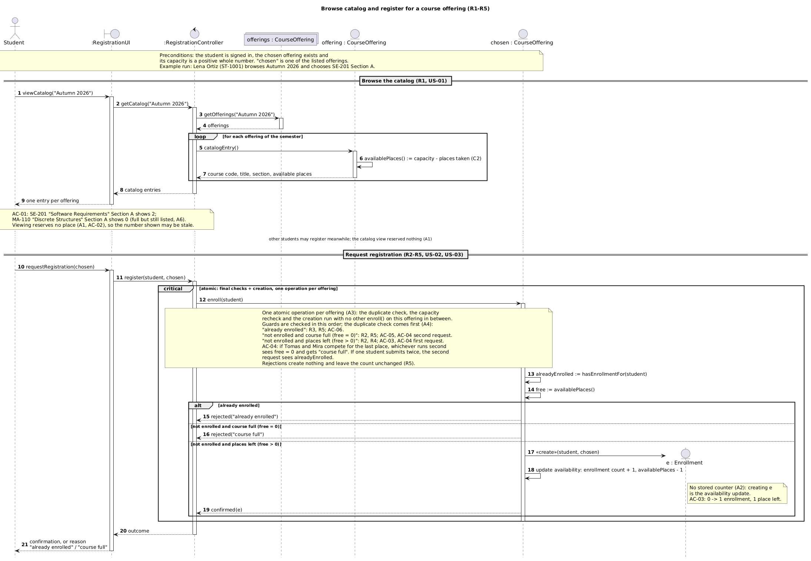
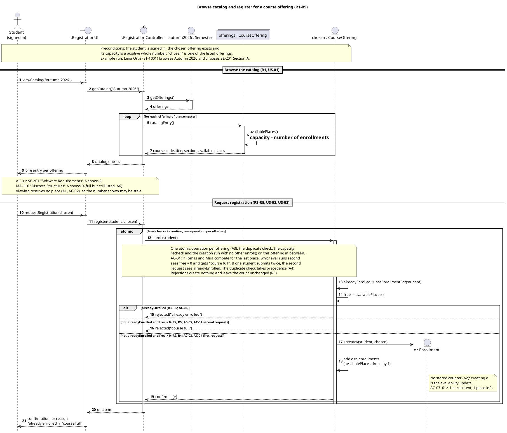
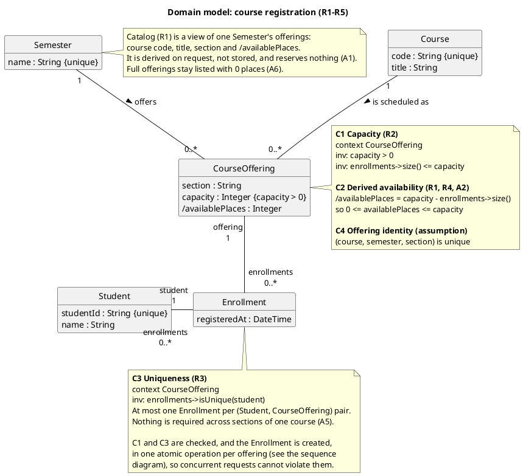
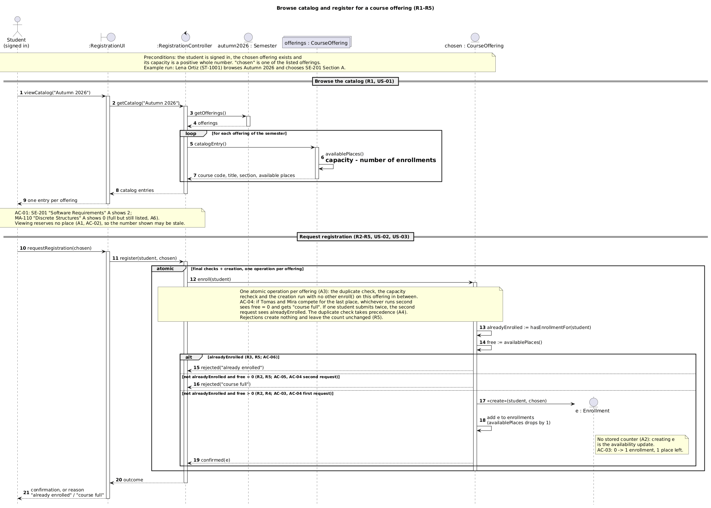
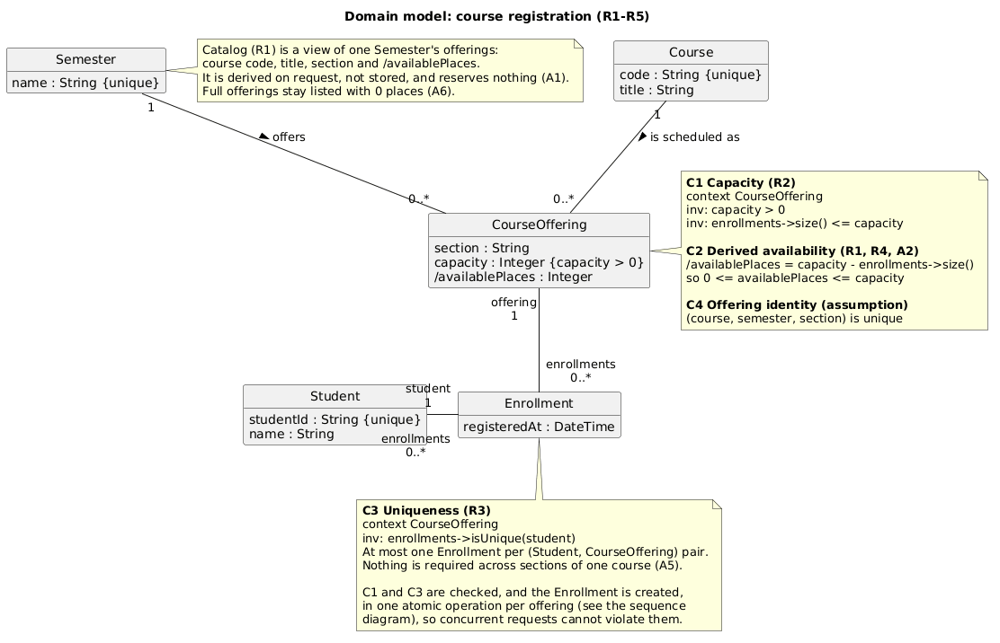

# SIS #02 — AI-Assisted UML Modeling: University Course Registration

<!--
  This is the only file you write your report in. README.md tells you what goes where.

  Rules the checker relies on:
  - Do not delete, rename or renumber the ## headings, the ### headings, or the **Label:** words.
  - Replace every "(write here)" and "(paste here)". None may be left when you submit.
  - Comments like this one are ignored by the checker and the word counter. Delete them or leave them.
-->

## 1. Scope and assumptions

<!-- Your FINAL scope statement and assumptions, after reviewing Prompt A's output. Say here
     what is out of scope (payments, prerequisites, timetable clashes, waiting lists,
     cancellation) — section 2 must not mention them. Section 10 keeps your first version. -->

**Scope:** One signed-in student browses the catalog of one semester, which shows each offering's course code, title, section and available places, picks a course offering and asks to register. When the request arrives the system rechecks, in one atomic operation, whether the student already holds an Enrollment in that offering and whether a place is still free, then either creates exactly one Enrollment and confirms it, or rejects the request with "already enrolled" or "course full" and changes nothing.

**Out of scope:** payments, prerequisites, timetable clashes, waiting lists and cancellation, which the scenario excludes. Also not modeled: how the confirmation is delivered, technical failures outside R5, and any database detail beyond a note that the final checks and the creation are atomic.

**Assumptions:**

1. A catalog view reserves nothing; the available places a student saw can be out of date when the request arrives, which is why R2 rechecks them.
2. Available places = capacity − number of Enrollments of the offering. They are derived, not stored, so creating the Enrollment is the availability update that R4 asks for (B1 uncertainty U-04).
3. The duplicate check, the capacity check and the creation of the Enrollment form one atomic operation per offering. This covers two students asking for the last place at once and also one student sending the same request twice at once (B1 suggested extending my initial assumption 4 to duplicates; accepted).
4. If a request is both a repeat and for a full offering, the reason is "already enrolled": the duplicate check runs first, because that answer is true whatever the capacity (B1 uncertainty U-01, my decision).
5. R3 limits repeats in the same offering only. Whether a student may hold places in two sections of one course is not decided by the rules, and no policy is added for it (U-02).
6. Full offerings stay in the catalog with 0 available places; the catalog is asked for one semester at a time (U-05, U-06).
7. Example data is fictional: students Lena Ortiz (ST-1001), Tomas Reyes (ST-1002) and Mira Holm (ST-1003); courses SE-201 "Software Requirements" and MA-110 "Discrete Structures"; semester Autumn 2026.

## 2. User stories and acceptance criteria

<!-- Your APPROVED requirements: Prompt A's draft after your review. Keep the IDs, the three
     story headings and the bullet shape. Every criterion names the rule(s) it maps to,
     e.g. (R2, R4). Two criteria per story. Nothing out of scope.
     Format of a criterion, on one bullet:
     - **AC-03** (R2, R4): Given ..., When ..., Then ... -->

### US-01 — Browse offerings

**US-01:** As a student, I want to see one semester's course offerings with their available places, so that I can choose an offering to register for.

- **AC-01** (R1): Given the Autumn 2026 catalog holds SE-201 "Software Requirements" Section A (capacity 2, 0 Enrollments) and MA-110 "Discrete Structures" Section A (capacity 20, 20 Enrollments), When Lena views the catalog for Autumn 2026, Then each offering is listed as its own entry with its course code, course title, section and available places, SE-201 Section A showing 2 and MA-110 Section A showing 0.
- **AC-02** (R1, R2): Given SE-201 Section A has capacity 2 and 1 Enrollment, When Tomas views the Autumn 2026 catalog, Then SE-201 Section A shows 1 available place (capacity minus Enrollments), And the enrollment count stays 1, because viewing the catalog holds no place for Tomas.

### US-02 — Register for an offering

**US-02:** As a student, I want to request registration for the offering I chose, so that I get a confirmed place in it while a place is free.

- **AC-03** (R2, R4): Given SE-201 Section A has capacity 2 and 0 Enrollments and Lena has no Enrollment in it, When Lena requests registration for SE-201 Section A, Then availability is rechecked at that moment, exactly one Enrollment linking Lena and SE-201 Section A is created, the enrollment count becomes 1 with 1 place left, And Lena receives a confirmation.
- **AC-04** (R2, R4, R5): Given SE-201 Section A has capacity 2 and 1 Enrollment and neither Tomas nor Mira holds an Enrollment in it, When Tomas and Mira request registration for SE-201 Section A at almost the same moment, Then exactly one of them gets a new Enrollment and a confirmation and the enrollment count becomes 2 with no place left, And the other is rejected with "course full" and gets no Enrollment, so the count never exceeds 2.

### US-03 — Receive a clear rejection

**US-03:** As a student, I want a clear reason when my registration request is rejected, so that I know why and that nothing was recorded.

- **AC-05** (R2, R5): Given Mira saw 1 available place for SE-201 Section A in the catalog, that place has since been taken so the offering now has 2 Enrollments for capacity 2, and Mira holds no Enrollment in it, When Mira requests registration for SE-201 Section A, Then the request is rejected with the reason "course full", And no Enrollment is created and the enrollment count stays 2.
- **AC-06** (R3, R5): Given SE-201 Section A has capacity 2 and 1 Enrollment, which is Lena's, When Lena requests registration for SE-201 Section A again, Then the request is rejected with the reason "already enrolled", And no Enrollment is created, the enrollment count stays 1 and Lena still holds exactly one Enrollment in it.

## 3. Sequence diagram

<!-- The FINAL diagram, rendered. Change .png to .svg if that is what you exported. -->



**Participants:** (write here — each lifeline and what it stands for)

**Atomic operation:** (write here — which messages form the one atomic step: the final duplicate check, the capacity check and the creation of the Enrollment, and why a catalog view reserves nothing)

**Where the Enrollment is created:** (write here — which message, which lifeline, and which class in section 4 it produces)

**Technical lifelines:** (write here — every lifeline that is NOT a class in the class diagram, by name, and why the difference in abstraction is fine. "None" if there are none.)

## 4. Class diagram

<!-- The FINAL diagram, rendered. -->


<!-- One row per association in classes.puml, read in both directions. -->

| Association | Read left to right | Read right to left |
| --- | --- | --- |
| (write here) | (write here) | (write here) |
| (write here) | (write here) | (write here) |
| (write here) | (write here) | (write here) |

**How an Enrollment links a student to an offering:** (write here)

**Capacity constraint:** (write here — and why multiplicity alone cannot express it)

**Uniqueness constraint:** (write here — and why multiplicity alone cannot express it)

## 5. Traceability

<!-- Every rule, including the catalog fields and availability (R1). Column 1: the rule and
     the criteria that cover it, e.g. "R2 + AC-03, AC-04". Column 2: the message, guard,
     class or constraint that shows the rule in YOUR diagrams. Column 3: the T-ID that
     exercises it, or the extra check you did instead (R1 has no T case). -->

| Rule and criterion | Model evidence | Validation case |
| --- | --- | --- |
| R1 + (write here) | (write here) | (write here) |
| R2 + (write here) | (write here) | (write here) |
| R3 + (write here) | (write here) | (write here) |
| R4 + (write here) | (write here) | (write here) |
| R5 + (write here) | (write here) | (write here) |

## 6. Walkthroughs

<!-- Walk each case through YOUR final sequence diagram, message by message. Column 2: the
     actual steps and the state change (count before → after). Column 3 starts with Pass or
     Fail, then the location: the message, guard or note where you saw it. A Fail you
     report honestly is a finding, not a penalty. -->

| Case | Observed path and state change | Judgment and evidence |
| --- | --- | --- |
| T1. Available | (write here) | (write here) |
| T2. Last place | (write here) | (write here) |
| T3. Full | (write here) | (write here) |
| T4. Duplicate | (write here) | (write here) |

## 7. Review decisions

<!-- At least three substantive decisions about Prompt C's critique or your own inspection.
     Decision: accepted / rejected / modified — and what you did. Reason: why, in a full
     sentence. Rule: R1–R5. Do not invent an error to fill the table; a justified rejection
     of advice counts. -->

| AI suggestion or model element | Decision | Reason | Rule |
| --- | --- | --- | --- |
| (write here) | (write here) | (write here) | (write here) |
| (write here) | (write here) | (write here) | (write here) |
| (write here) | (write here) | (write here) | (write here) |

## 8. Modeling explanation

<!-- 200–300 words. Your main design choices; how the class diagram and the sequence diagram
     complement each other; why an activity diagram could also help explain the workflow. -->

(write here)

## 9. Reflection

<!-- 150–200 words. Written by you, not by the assistant: where AI helped, one decision you
     made yourself, one remaining limitation. Specific beats flattering. -->

(write here)

## 10. Appendix A — Before AI

<!-- Written BEFORE you run Prompt A, committed and pushed in your first commit, and never
     edited afterwards. This is what you paste into Prompt A as "My initial assumptions". -->

**Scope:** One signed-in student browses the course catalog of one semester, picks a course offering and asks to register; at that moment the system rechecks whether the student is already enrolled and whether the offering still has a free place, then either creates exactly one Enrollment and confirms it or rejects the request with "course full" or "already enrolled" and changes nothing.

**Initial assumptions:**

1. There is no waiting list: a request for a full offering is rejected and nothing is queued.
2. A catalog view does not reserve a place, so the free places a student saw may be out of date by the time the request arrives.
3. The free places of an offering are its capacity minus the number of Enrollments it already has.
4. Two students can ask for the last place at almost the same moment; only one of them may get it.

## 11. Appendix B — AI exchanges

<!-- Complete prompts and complete responses, as text — never screenshots. Paste each inside
     the ~~~~ block that follows its label: AI responses contain ``` PlantUML blocks, and
     ~~~~ keeps them from breaking this file. Prompts B and C: the prompt text first, then
     the material it refers to ("below", "these two") pasted under it, in the same block.
     You may add B5, B6 … after B4 if you ran more. -->

### B1 — Requirements (Prompt A)

- **Tool:** Claude Code v2.1.296 (headless claude -p, tools disabled)
- **Model:** claude-opus-5-5 (Claude Opus 5.5)
- **Date:** 2026-10-11
- **Purpose:** draft 3 user stories and 6 acceptance criteria

<!-- Model: the exact model with its version, as the tool shows it (e.g. "GPT-5 Thinking",
     "Claude Sonnet 4.5"). If the tool does not show it, write: not displayed
     Date: YYYY-MM-DD -->

**Prompt:**

~~~~text
Act as a requirements analyst. Use only this course registration scenario and rules R1–R5:

Scenario: A student browses an electronic course catalog, chooses a course offering and requests registration. Each offering has a limited number of places. A Course describes a subject. A CourseOffering is one scheduled section in one semester. Registration always targets a specific offering. Assume that the student is signed in, the selected offering exists, and its capacity is a positive whole number. Exclude payments, prerequisites, timetable clashes, waiting lists and cancellation. Use fictional students and courses.

R1. Catalog: Show the course code, title, offering and available places for one semester.
R2. Capacity: Recheck current availability when registering. Enrollment must never exceed the offering's capacity.
R3. Duplicates: A student may have at most one enrollment in the same offering. Reject a repeat request.
R4. Success: Create exactly one Enrollment linking the student and offering, update availability and return a confirmation.
R5. Rejection: Explain "course full" or "already enrolled". Create no enrollment and leave the enrollment count unchanged.

These rules define this assignment. A catalog view does not reserve a place. Model the final checks and enrollment creation as one atomic operation so competing requests cannot take the same last place. A note describing the atomic operation is sufficient; database implementation is outside this assignment. My initial assumptions are

1. There is no waiting list: a request for a full offering is rejected and nothing is queued.
2. A catalog view does not reserve a place, so the free places a student saw may be out of date by the time the request arrives.
3. The free places of an offering are its capacity minus the number of Enrollments it already has.
4. Two students can ask for the last place at almost the same moment; only one of them may get it.
Draft 3 user stories and 2 Given / When / Then acceptance criteria for each. Use IDs US-01 to US-03 and AC-01 to AC-06. Map each criterion to rule IDs.
Cover normal and rejection behavior. List uncertainty separately. Do not add excluded features or invent university policies.
~~~~

**Response:**

~~~~text
# Course Registration: User Stories and Acceptance Criteria

## Fictional Test Data

| Element | Values |
|---|---|
| Students | Lena Ortiz (ST-1001), Tomas Reyes (ST-1002), both signed in |
| Semester | Autumn 2026 |
| Courses | SE-201 "Software Requirements", MA-110 "Discrete Structures" |
| Offerings | SE-201 Section A (capacity 30), SE-201 Section B (capacity 25), MA-110 Section A (capacity 20) |

**Terms:** *Enrollment count* means the number of Enrollments for one offering. *Available places* means capacity minus enrollment count (A3).

## Review of Your Assumptions

| ID | Assumption | Analyst comment |
|---|---|---|
| A1 | No waiting list; full means rejected, nothing queued | Matches the exclusions and R5. |
| A2 | Catalog view reserves nothing; the shown number may be stale | Matches the scenario. This is why R2 requires a recheck. |
| A3 | Available places = capacity − Enrollments | Consistent with R1, R2 and R4. Because cancellation is excluded, every Enrollment counts. |
| A4 | Two students racing for the last place; only one wins | Matches R2. **I suggest extending it** to cover the duplicate check too. One student sending the same request twice at once could otherwise get two Enrollments, which would break R3. |

## User Stories and Acceptance Criteria

### US-01: Browse the course catalog
**As a** student, **I want** to see the offerings of one semester with their available places, **so that** I can choose an offering to register for.

**AC-01: Catalog shows required fields per offering** (R1)
- **Given** semester Autumn 2026 has the offerings SE-201 Section A, SE-201 Section B and MA-110 Section A
- **When** Lena views the catalog for Autumn 2026
- **Then** each offering is listed as a separate entry showing its course code, course title, offering (section) and available places
- **And** SE-201 Section A and SE-201 Section B appear as two entries for the same course

**AC-02: Available places are derived, and viewing reserves nothing** (R1; supports A2, A3)
- **Given** SE-201 Section A has capacity 30 and 28 Enrollments
- **When** Lena views the catalog
- **Then** SE-201 Section A shows 2 available places
- **And** the enrollment count remains 28 and no place is held for Lena

### US-02: Register for an offering with a free place
**As a** student, **I want** to request registration for a chosen offering, **so that** I receive a confirmed place in it.

**AC-03: Successful registration** (R2, R4)
- **Given** SE-201 Section A has capacity 30 and 28 Enrollments, and Lena has no Enrollment in it
- **When** Lena requests registration for SE-201 Section A
- **Then** current availability is rechecked at the time of the request
- **And** exactly one Enrollment linking Lena and SE-201 Section A is created
- **And** the enrollment count becomes 29 and available places become 1
- **And** Lena receives a confirmation

**AC-04: Competing requests for the last place** (R2, R4, R5; A4)
- **Given** SE-201 Section B has capacity 25 and 24 Enrollments, and neither Lena nor Tomas has an Enrollment in it
- **When** Lena and Tomas request registration for SE-201 Section B at almost the same moment
- **Then** exactly one request succeeds and creates one Enrollment, and that student receives a confirmation
- **And** the other request is rejected with "course full" and creates no Enrollment
- **And** the final enrollment count is 25, never 26

### US-03: Understand why registration was rejected
**As a** student, **I want** a clear reason when my registration is rejected, **so that** I know nothing was recorded and why.

**AC-05: Offering became full after the catalog was viewed** (R2, R5; A1, A2)
- **Given** Tomas saw 1 available place for MA-110 Section A in the catalog
- **And** that place was then taken, so MA-110 Section A now has capacity 20 and 20 Enrollments
- **And** Tomas has no Enrollment in MA-110 Section A
- **When** Tomas requests registration for MA-110 Section A
- **Then** the request is rejected with the reason "course full"
- **And** no Enrollment is created, the enrollment count remains 20, and the request is not queued

**AC-06: Repeat request for the same offering** (R3, R5)
- **Given** Lena already has an Enrollment in SE-201 Section A, which has capacity 30 and 29 Enrollments
- **When** Lena requests registration for SE-201 Section A again
- **Then** the request is rejected with the reason "already enrolled"
- **And** no Enrollment is created, the enrollment count remains 29, and Lena still has exactly one Enrollment in SE-201 Section A

*AC-06 deliberately leaves free places, so "already enrolled" is the only reason that applies (see U-01).*

## Atomic Operation Note

**RegisterForOffering(student, offering)** is a single indivisible operation:

1. **Duplicate check:** if the student already has an Enrollment in this offering, reject with "already enrolled".
2. **Capacity check:** if the enrollment count is greater than or equal to capacity, reject with "course full".
3. **Create** one Enrollment linking the student and the offering. Available places therefore drop by 1.
4. **Return** a confirmation.

Either all steps take effect or none do. Requests for the same offering are handled one after another, so each request's checks see every earlier successful Enrollment. Two invariants must always hold:
- **Capacity:** for every offering, the enrollment count is at most its capacity.
- **No duplicates:** for every student and offering pair, there is at most one Enrollment.

The order of steps 1 and 2 is not fixed by the rules (see U-01).

## Traceability

| Rule | Acceptance criteria |
|---|---|
| R1 Catalog | AC-01, AC-02 |
| R2 Capacity | AC-03, AC-04, AC-05 |
| R3 Duplicates | AC-06 |
| R4 Success | AC-03, AC-04 |
| R5 Rejection | AC-04, AC-05, AC-06 |

## Uncertainties (to confirm with stakeholders)

| ID | Question | Why it matters |
|---|---|---|
| U-01 | If a student is already enrolled **and** the offering is full, which reason is shown? | R5 defines both reasons but no precedence. This decides the check order in the atomic operation. |
| U-02 | May a student enroll in two different offerings of the **same course** (e.g., SE-201 Sections A and B)? | R3 only forbids repeats of the same offering. The rules are silent here, so no policy was assumed. |
| U-03 | If the same student sends two simultaneous requests, should the second always get "already enrolled"? | This depends on extending A4 to the duplicate check (see the assumption review). |
| U-04 | Is "available places" stored or always calculated? | R4 says "update availability". If it is calculated (A3), the update is implicit. If it is stored, it must change in the same atomic step. |
| U-05 | Are full offerings listed with 0 available places, or hidden? | R1 does not say. |
| U-06 | How is the one semester chosen: does the student pick it, or is there a default? | R1 says only "for one semester". |
| U-07 | What must the confirmation contain, and how is it delivered? | R4 requires a confirmation but does not define it. |
| U-08 | Are "course full" and "already enrolled" exact message texts or just meanings? | This affects how testers verify AC-04 to AC-06. |
| U-09 | What does the student see if registration fails for a reason outside R5, such as a technical error? | Not covered by R1–R5. Atomicity only guarantees that no partial Enrollment is created. |
~~~~

### B2 — UML drafts (Prompt B)

- **Tool:** Claude Code v2.1.296 (headless claude -p, tools disabled)
- **Model:** claude-opus-5-5 (Claude Opus 5.5)
- **Date:** 2026-10-11
- **Purpose:** draft the sequence and class diagrams

**Prompt:**

~~~~text
Using my approved scenario, R1–R5, stories and criteria below, return separate PlantUML code blocks for a sequence diagram and a domain class diagram.
Sequence: include catalog browsing and guarded success, full-course and duplicate outcomes. Model final checks and creation as one atomic operation.
Class: show domain concepts, useful attributes and multiplicities. State the capacity and uniqueness constraints. Explain assumptions and any technical lifelines.

Scenario:
A student browses an electronic course catalog, chooses a course offering and requests
registration. Each offering has a limited number of places.

A Course describes a subject. A CourseOffering is one scheduled section in one semester.
Registration always targets a specific offering.

Assume that the student is signed in, the selected offering exists, and its capacity is a
positive whole number.

Exclude payments, prerequisites, timetable clashes, waiting lists and cancellation. Use
fictional students and courses.

Rules:
R1. Catalog: Show the course code, title, offering and available places for one semester.
R2. Capacity: Recheck current availability when registering. Enrollment must never exceed the offering's capacity.
R3. Duplicates: A student may have at most one enrollment in the same offering. Reject a repeat request.
R4. Success: Create exactly one Enrollment linking the student and offering, update availability and return a confirmation.
R5. Rejection: Explain "course full" or "already enrolled". Create no enrollment and leave the enrollment count unchanged.

These rules define this assignment. A catalog view does not reserve a place. Model the final
checks and enrollment creation as one atomic operation so competing requests cannot take the same
last place. A note describing the atomic operation is sufficient; database implementation is
outside this assignment.

Approved scope and assumptions:

**Scope:** One signed-in student browses the catalog of one semester, which shows each offering's course code, title, section and available places, picks a course offering and asks to register. When the request arrives the system rechecks, in one atomic operation, whether the student already holds an Enrollment in that offering and whether a place is still free, then either creates exactly one Enrollment and confirms it, or rejects the request with "already enrolled" or "course full" and changes nothing.

**Out of scope:** payments, prerequisites, timetable clashes, waiting lists and cancellation, which the scenario excludes. Also not modeled: how the confirmation is delivered, technical failures outside R5, and any database detail beyond a note that the final checks and the creation are atomic.

**Assumptions:**

1. A catalog view reserves nothing; the available places a student saw can be out of date when the request arrives, which is why R2 rechecks them.
2. Available places = capacity − number of Enrollments of the offering. They are derived, not stored, so creating the Enrollment is the availability update that R4 asks for (B1 uncertainty U-04).
3. The duplicate check, the capacity check and the creation of the Enrollment form one atomic operation per offering. This covers two students asking for the last place at once and also one student sending the same request twice at once (B1 suggested extending my initial assumption 4 to duplicates; accepted).
4. If a request is both a repeat and for a full offering, the reason is "already enrolled": the duplicate check runs first, because that answer is true whatever the capacity (B1 uncertainty U-01, my decision).
5. R3 limits repeats in the same offering only. Whether a student may hold places in two sections of one course is not decided by the rules, and no policy is added for it (U-02).
6. Full offerings stay in the catalog with 0 available places; the catalog is asked for one semester at a time (U-05, U-06).
7. Example data is fictional: students Lena Ortiz (ST-1001), Tomas Reyes (ST-1002) and Mira Holm (ST-1003); courses SE-201 "Software Requirements" and MA-110 "Discrete Structures"; semester Autumn 2026.

Approved user stories and acceptance criteria:

### US-01 — Browse offerings

**US-01:** As a student, I want to see one semester's course offerings with their available places, so that I can choose an offering to register for.

- **AC-01** (R1): Given the Autumn 2026 catalog holds SE-201 "Software Requirements" Section A (capacity 2, 0 Enrollments) and MA-110 "Discrete Structures" Section A (capacity 20, 20 Enrollments), When Lena views the catalog for Autumn 2026, Then each offering is listed as its own entry with its course code, course title, section and available places, SE-201 Section A showing 2 and MA-110 Section A showing 0.
- **AC-02** (R1, R2): Given SE-201 Section A has capacity 2 and 1 Enrollment, When Tomas views the Autumn 2026 catalog, Then SE-201 Section A shows 1 available place (capacity minus Enrollments), And the enrollment count stays 1, because viewing the catalog holds no place for Tomas.

### US-02 — Register for an offering

**US-02:** As a student, I want to request registration for the offering I chose, so that I get a confirmed place in it while a place is free.

- **AC-03** (R2, R4): Given SE-201 Section A has capacity 2 and 0 Enrollments and Lena has no Enrollment in it, When Lena requests registration for SE-201 Section A, Then availability is rechecked at that moment, exactly one Enrollment linking Lena and SE-201 Section A is created, the enrollment count becomes 1 with 1 place left, And Lena receives a confirmation.
- **AC-04** (R2, R4, R5): Given SE-201 Section A has capacity 2 and 1 Enrollment and neither Tomas nor Mira holds an Enrollment in it, When Tomas and Mira request registration for SE-201 Section A at almost the same moment, Then exactly one of them gets a new Enrollment and a confirmation and the enrollment count becomes 2 with no place left, And the other is rejected with "course full" and gets no Enrollment, so the count never exceeds 2.

### US-03 — Receive a clear rejection

**US-03:** As a student, I want a clear reason when my registration request is rejected, so that I know why and that nothing was recorded.

- **AC-05** (R2, R5): Given Mira saw 1 available place for SE-201 Section A in the catalog, that place has since been taken so the offering now has 2 Enrollments for capacity 2, and Mira holds no Enrollment in it, When Mira requests registration for SE-201 Section A, Then the request is rejected with the reason "course full", And no Enrollment is created and the enrollment count stays 2.
- **AC-06** (R3, R5): Given SE-201 Section A has capacity 2 and 1 Enrollment, which is Lena's, When Lena requests registration for SE-201 Section A again, Then the request is rejected with the reason "already enrolled", And no Enrollment is created, the enrollment count stays 1 and Lena still holds exactly one Enrollment in it.
~~~~

**Response:**

~~~~text
## Sequence diagram



## Domain class diagram



## Constraints

- **C1 Capacity (R2):** `capacity > 0`, and an offering never has more Enrollments than its capacity.
- **C2 Derived availability (A2):** `availablePlaces = capacity − number of Enrollments`. It always stays between 0 and capacity. It is never stored, so creating an Enrollment is the update R4 asks for.
- **C3 Uniqueness (R3):** a student has at most one Enrollment per offering. A repeat request is rejected with "already enrolled".
- **Enforcement:** both C1 and C3 are guaranteed by the atomic `enroll()` on the offering. Every Enrollment links exactly one Student and one CourseOffering (the 1-multiplicities, R4).

## Assumptions and modelling decisions

Beyond your approved A1–A7, I made these choices:

1. **The atomic operation belongs to `CourseOffering.enroll()`.** The offering owns its capacity and its Enrollments, so it is the natural boundary for "one operation per offering" (A3). How the operation is made atomic (locks, transactions) is left out, as you specified.
2. **There are three branches with mutually exclusive guards.** Both values are read inside the atomic group. The guards include "not alreadyEnrolled", so a repeat request for a full offering gets "already enrolled" (A4).
3. **The reply is outside the atomic group.** Only the checks and the creation are atomic. The single `outcome` reply carries the confirmation or the reason, and how it is delivered is out of scope.
4. **Concurrency is shown as a note, not a second actor.** Using one generic Student keeps the diagram readable. AC-04 and the double-submit case are explained in the atomic note. A `par` fragment with Tomas and Mira would be an alternative if your course expects one.
5. **Catalog is not a class.** It is the derived view of one Semester's offerings and holds no state. Course code and title come through the offering's link to its Course.
6. **Enrollment is a class of its own, not a UML association class.** This makes C3 an explicit constraint rather than leaving it implied by association-class semantics.
7. **Some attributes are not required by R1–R5:** `Student.name`, `Enrollment.registeredAt` and the C4 identity of (course, semester, section). I added them because they are useful for identification and confirmation, but you can drop them.
8. **The domain model has no operations.** `enroll()`, `availablePlaces()` and `hasEnrollmentFor()` in the sequence diagram are responsibilities given to CourseOffering at design level.

## Technical lifelines

- **`:RegistrationUI` (boundary):** the interface the student uses. It forwards requests and shows the catalog and the outcome. It contains no business rules.
- **`:RegistrationController` (control):** coordinates the use case. It identifies the signed-in student and the chosen offering, gets the semester's offerings, hands the atomic `enroll()` to the offering and passes the result back. It holds no business state and performs no checks itself, so R2–R5 stay in the domain.

Neither appears in the class diagram because they are not domain concepts. For a black-box view, both can be merged into a single `:RegistrationSystem` lifeline. The other lifelines (Semester, the `offerings` multi-object, the chosen CourseOffering and the created Enrollment) are domain objects.

I haven't rendered the diagrams here; the syntax is standard PlantUML (`create`, `group`, `collections`, creole notes).
~~~~

### B3 — Model critique (Prompt C)

- **Tool:** (write here)
- **Model:** (write here)
- **Date:** (write here)
- **Purpose:** review both models against R1–R5 and T1–T4

**Prompt:**

~~~~text
(paste here)
~~~~

**Response:**

~~~~text
(paste here)
~~~~

### B4 — Focused revision (Prompt D)

- **Tool:** (write here)
- **Model:** (write here)
- **Date:** (write here)
- **Purpose:** apply my accepted review decisions

**Prompt:**

~~~~text
(paste here)
~~~~

**Response:**

~~~~text
(paste here)
~~~~

## 12. Appendix C — Original diagrams

<!-- The AI's first output from Prompt B, rendered unedited from models/original/. -->





## 13. Appendix D — References and source checks

### References

<!-- Full references, one per line, each starting with "- ". Only sources you actually opened.
     Every URL used in the source checks must also appear here. Example:
     - Sommerville, I. (2016). Software Engineering, 10th ed., Global Edition. Pearson. Ch. 5. -->

- (write here)

### Source checks

<!-- At least two modeling decisions you verified. Source and locator: title + slide, page,
     section, chapter or figure — or title + URL + access date (YYYY-MM-DD). Slide numbers
     refer to the decks posted in our Teams. -->

| Modeling decision | Source and locator | What the source says | How it supports or changed your model |
| --- | --- | --- | --- |
| (write here) | (write here) | (write here) | (write here) |
| (write here) | (write here) | (write here) | (write here) |
