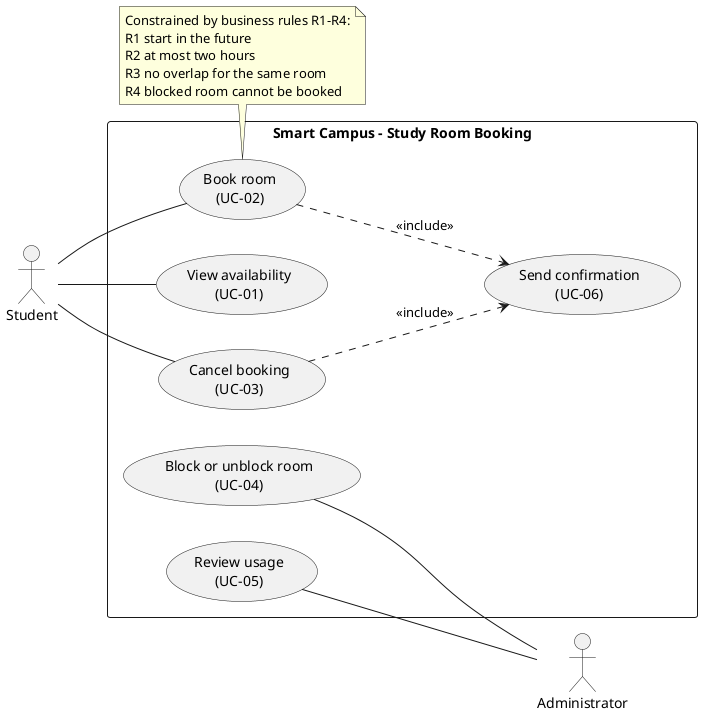

# PlantUML Use-Case Diagram: Smart Campus Study Room Booking

## Modelling decisions

**Actor associations**
- **Student** connects to View availability, Book room and Cancel booking. The scenario says students reserve rooms and release their own reservations.
- **Administrator** connects to Block or unblock room and Review usage. These match "keep rooms usable" and "watch how they are used."
- **Administrator has no link to View availability.** The scenario never says the administrator uses it, so adding the link would widen the system.

**Send confirmation**
- Book room and Cancel booking both **`<<include>>`** it. UC-06 says the system confirms a booking or a cancellation, so confirming is a required part of completing either one. It is not an optional add-on, which is why `<<extend>>` is not used.
- **It has no direct actor association.** The student who gets the confirmation is already the primary actor of the base use case. A notification channel (SMS, push, reminders) would also be out of scope.

**Relationships deliberately not drawn**
- **Book room does not include View availability.** A student can book without browsing first. Checking R3 and R4 happens inside Book room, not by running UC-01.
- **No `<<extend>>` relationships.** The scenario describes no optional or conditional behaviour that clearly extends another use case.
- **No actor generalisation.** Nothing says an Administrator is also a Student.

**Business-rule note**
- The note quotes R1–R4 exactly as written. It does **not** settle the two open questions:
  - whether back-to-back bookings overlap
  - whether exactly two hours is allowed
- Those decisions belong in your assumptions and in `submission.yml`, not in the diagram.

**Out of scope**
- The diagram contains no screens, databases, classes, payments, check-in, authentication, waiting lists or extra notifications.

You can save the code as `use-case-diagram.puml` and render it with the PlantUML extension or at plantuml.com.