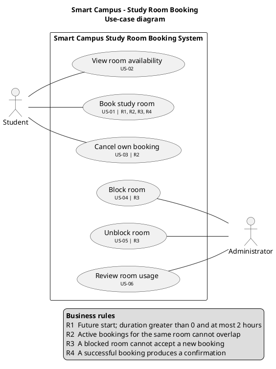

# Use-case diagram: Smart Campus study room booking

I haven't rendered this here, so please check it in your PlantUML tool. The associations are plain lines, without arrowheads, because a UML actor association has no direction.

## Associations

| Actor | Use case | Story | Why this association |
|---|---|---|---|
| Student | View room availability | US-02 | The story's actor is a student. |
| Student | Book study room | US-01 | The story's actor is a student, and the student receives the confirmation (R4). |
| Student | Cancel own booking | US-03 | The story's actor is a student. Only the booking's owner cancels it. |
| Administrator | Block room | US-04 | The story's actor is an administrator. |
| Administrator | Unblock room | US-05 | The story's actor is an administrator. |
| Administrator | Review room usage | US-06 | The story's actor is an administrator. |

I left out some associations on purpose. No story lets an Administrator book, cancel or view availability, and no story lets a Student block, unblock or review usage.

## Why there is no «include» or «extend»

I looked for a clear reason to use each one and didn't find any:

| Candidate | Decision | Reason |
|---|---|---|
| Book «include» *Check booking rules* (R1–R3) | Rejected | The checks are internal steps of one use case, not a goal of any actor. Only Book uses them, so splitting them out would be functional decomposition. |
| Book «include» *Send confirmation* (R4) | Rejected | Only one use case needs it, and it happens on every successful booking. That makes it part of Book's success outcome, not a separate behaviour. |
| Book «extend» View availability (or the reverse) | Rejected | US-01 and US-02 are separate goals. A student can book without viewing first. "So that I can choose one before booking" explains the student's motive; it doesn't make one behaviour depend on the other. |
| Any use case «include» *Log in* | Rejected | Authentication isn't part of the scenario, and registration is explicitly out of scope. |

## Assumptions

1. **A1:** Users are already identified when they use the system, which is how "own" in US-03 can be enforced. Login and registration are outside the system boundary, so they aren't modelled.
2. **A2:** Administrator is not a specialised Student. There is no generalisation between them, because no story gives administrators any student goals.
3. **A3:** The system itself issues the confirmation (R4) to the Student. The scenario names no email or notification service, so there is no secondary actor. If your course expects one, you would add it to Book study room.
4. **A4:** Block and Unblock are two separate use cases rather than a single "Manage room status". They are separate stories (US-04 and US-05), and keeping them apart keeps the story IDs traceable.
5. **A5:** Unblock room only makes sense for a room that is currently blocked. That is a precondition, not a separate use case.
6. **A6:** Review room usage is read-only. The scenario doesn't say what the review contains, such as reports, periods or metrics, so I haven't modelled any detail.
7. **A7:** Blocking stops *new* bookings only (R3). The scenario doesn't say what happens to existing bookings for a blocked room. **This is an open question**, and it isn't shown in the diagram.
8. **A8:** No story lets an administrator cancel another user's booking, so that isn't modelled.
9. **A9:** Time passing, for example bookings that end and become inactive, isn't triggered by any actor, so there is no Time or Clock actor.

Ready for the next diagram.