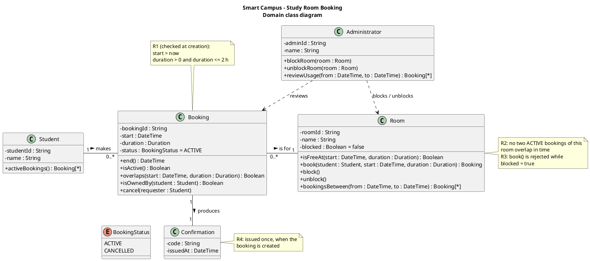

# Domain class diagram: Smart Campus study room booking

I haven't rendered this here, so please check it in your PlantUML tool.

## Relationships

| Relationship | Multiplicity | Explanation |
|---|---|---|
| Student — Booking, "makes" | 1 to 0..* | **US-01, US-03.** Each booking has exactly one owner, which US-03 needs in order to enforce "own" bookings. A student can have no bookings or many, because no rule limits how many bookings a student may hold. |
| Booking — Room, "is for" | 0..* to 1 | **US-01, US-02.** Each booking is for exactly one room, and a room can have many bookings. R2 is checked over a room's set of bookings, and so is availability (US-02). |
| Booking — Confirmation, "produces" | 1 to 1 | **R4.** A Booking object exists only when a booking succeeds, so every Booking has exactly one Confirmation, and each Confirmation belongs to one Booking. |
| Administrator ⇢ Room | dependency | **US-04, US-05.** The administrator acts on a room but the system stores no link between them, because no requirement records *which* administrator blocked a room. |
| Administrator ⇢ Booking | dependency | **US-06.** The administrator reads bookings to review usage, and again no link is stored. |
| Booking uses BookingStatus | attribute type | **R2, US-03.** R2 talks about *active* bookings, and cancelling (US-03) has to make a booking stop being active without deleting it. |

### Relationships I left out on purpose

- **No Student — Room association.** It can be derived through Booking, so a direct link would be redundant and could contradict the bookings.
- **Booking is a full class, not an association class between Student and Room.** An association class allows only one link per student–room pair, but a student can book the same room many times.
- **No composition.**
  - Room — Booking is not composition, because a booking also belongs to a student, so it isn't simply a part of a room.
  - Booking — Confirmation is not composition, because no requirement deletes either one. Cancelling changes the status, and the records stay.
  - Composition would therefore claim a lifecycle that the requirements never state.
- **No inheritance.**
  - There is no `User` superclass above Student and Administrator. The stories give them no shared attributes or behaviour, and login and registration are out of scope.
  - BookingStatus is an enum, not subclasses such as `ActiveBooking` and `CancelledBooking`. A booking changes state, so changing its class would be the wrong model.

## Where the operations live

| Operation | Story or rule | Why this class |
|---|---|---|
| `Room.book(...)` | US-01, R1–R4 | Room holds both `blocked` (R3) and its bookings (R2), so it can check both. It creates the Booking, which in turn gets its Confirmation. |
| `Room.isFreeAt(...)` | US-02, R2, R3 | Room uses the same data that `book()` checks. |
| `Booking.overlaps(...)`, `end()`, `isActive()` | R2 | Each booking knows its own time interval and status. |
| `Booking.cancel(requester)` | US-03 | It checks `isOwnedBy(requester)`, then sets the status to CANCELLED, which frees the slot under R2. |
| `Student.activeBookings()` | US-03 | A student needs to see their own bookings in order to pick one to cancel. |
| `Room.block()` / `unblock()` | US-04, US-05, R3 | These change the room's own state. |
| `Administrator.blockRoom/unblockRoom/reviewUsage` | US-04–06 | These show that only administrators may do these things. They hand the work to Room. |

## Assumptions

1. **A1:** Only successful bookings are stored. A rejected attempt (R1–R3) doesn't create a Booking. This is why Confirmation is 1 rather than 0..1.
2. **A2:** "Active" means `status = ACTIVE`, which is the same as not cancelled. Past bookings still have ACTIVE status, but that's harmless:
   - A new booking must start in the future (R1), so it can never overlap a booking that has already ended.
   - A booking that is in progress still correctly blocks any overlapping slot.
3. **A3:** A booking's time is treated as the interval [start, start + duration). A booking ending at 10:00 doesn't overlap one starting at 10:00.
4. **A4:** I made Confirmation a class rather than an attribute because R4 names it as a separate thing the booking produces, and later diagrams will show it being created. Its contents (`code`, `issuedAt`) are my assumption, and I haven't modelled how it is delivered. If you prefer the simpler model, you can replace it with a `confirmationCode` attribute on Booking.
5. **A5:** "Now" is the system clock at the moment `book()` is called. Time zones aren't modelled.
6. **A6:** Cancelling needs the requester to be the owner and the status to be ACTIVE. Cancelling doesn't produce a notification, because other notifications are out of scope. **Open question:** may a student cancel a booking that has already started or ended?
7. **A7:** Blocking a room doesn't change its existing bookings. This carries over the open question from the use-case diagram.
8. **A8:** "Usage" means a room's bookings over a period, possibly including cancelled ones. No usage metrics are defined, so there is no `UsageReport` class.
9. **A9:** Room has no `capacity` attribute. "Plan capacity" is the administrator's motive in US-06, not a room property that any rule uses. Equipment is out of scope.
10. **A10:** No story covers creating or removing rooms, students or administrators, so there are no operations for that. Login and registration are out of scope.

Ready for the next diagram.