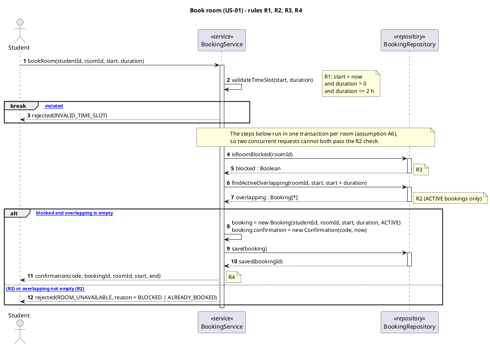

# Sequence diagram: Book room (US-01)

I haven't rendered this here, so please check it in your PlantUML tool.

## How the flow covers the rules

| Step | Rule | What happens |
|---|---|---|
| `validateTimeSlot` | R1 | Checked first and inside the service, because it needs only the request data and no repository call. |
| `break [R1 violated]` | R1 | An invalid time slot is not an "unavailable room", so it isn't a branch of the alt. `break` means the rest of the interaction is skipped. |
| `isRoomBlocked` | R3 | The service reads the room's blocked state. |
| `findActiveOverlapping` | R2 | Only ACTIVE bookings count, so cancelled ones are ignored (US-03). |
| `alt`, first branch: `save`, then `confirmation` | R4 | This is the reservation attempt. The student gets a confirmation only after `save` succeeds. |
| `alt`, `else` branch | R2, R3 | Both failures come back as a single "room unavailable" result, with a reason that says which rule failed. |

## New design components

These elements don't appear in the use-case or domain diagrams.

- **BookingService «service».** This is a control object and the entry point for US-01. It:
  - checks R1,
  - gets the data it needs for R2 and R3 from the repository and decides the outcome,
  - creates the Booking and its Confirmation,
  - replies to the student.

  It takes over the job of `Room.book()` from the domain model.
- **BookingRepository «repository».** This is a persistence abstraction that hides how bookings are stored. It:
  - offers two queries, `isRoomBlocked` and `findActiveOverlapping`, plus `save`,
  - runs the transaction described in A6.

  You asked for these three lifelines only, so it also answers the room query. A fuller design might add a separate `RoomRepository`.
- **Result values.** `confirmation(...)`, `rejected(INVALID_TIME_SLOT)` and `rejected(ROOM_UNAVAILABLE, reason)` are values returned by the call, not new domain classes. In code they could be one `BookingResult` type.

**Effect on consistency (for §7).** The domain model gave booking to `Room.book()`, `Room.isFreeAt()` and `Booking.overlaps()`. In this design:
- BookingService coordinates the work,
- the overlap condition moves into the `findActiveOverlapping` query,
- Booking refers to its student and room by IDs rather than object references.

Your consistency table should either record this mapping or add BookingService and BookingRepository to a design-level class diagram.

## Assumptions

1. **A1:** The UI layer is left out. Student messages go straight to BookingService.
2. **A2:** `studentId` comes from the authenticated session, not from user input. This carries over A1 from the use-case diagram.
3. **A3:** `roomId` refers to a room that exists, picked from the availability view (US-02). What happens with an unknown room isn't shown.
4. **A4:** "Now" for R1 is the server clock when the request is validated.
5. **A5:** The overlap test treats time slots as half-open intervals: `existing.start < newEnd AND newStart < existing.end AND status = ACTIVE`. This matches A3 in the domain model.
6. **A6:** The blocked check, the overlap query and the save run as one atomic unit for each room, for example a transaction or a lock on the room. Without this, two concurrent requests, or an administrator blocking the room at the same moment, could both get past R2 or R3. I've shown this as a note so the main flow stays readable. A UML `critical` fragment would be the formal way to show it.
7. **A7:** The Confirmation is created along with the Booking and saved in the same `save`, because Booking and Confirmation are 1 to 1. It reaches the student only once the save succeeds. So no confirmation can exist for a booking that wasn't stored, which keeps R4 safe.
8. **A8:** The confirmation is delivered as the reply to the student's request. There's no email or notification service, which matches A3 in the use-case diagram. How the `code` is generated isn't specified; it only needs to be unique.
9. **A9:** A rejected request tells the student which rule failed (`BLOCKED` or `ALREADY_BOOKED`), but not who holds the slot.
10. **A10:** Technical failures, such as the database being unavailable or a timeout, aren't modelled.

Ready for the next diagram.